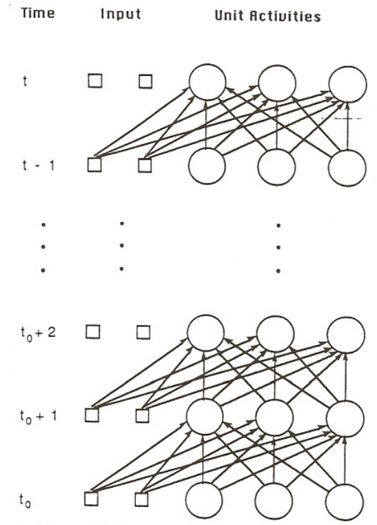
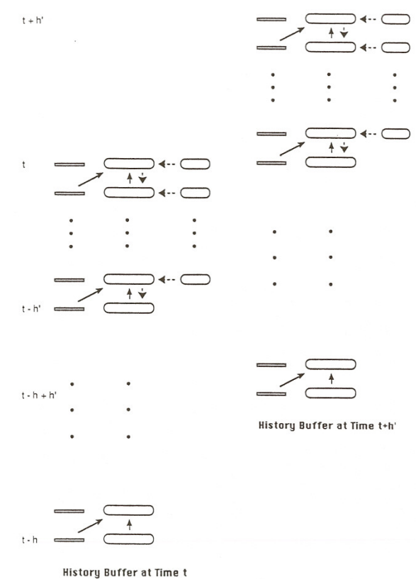
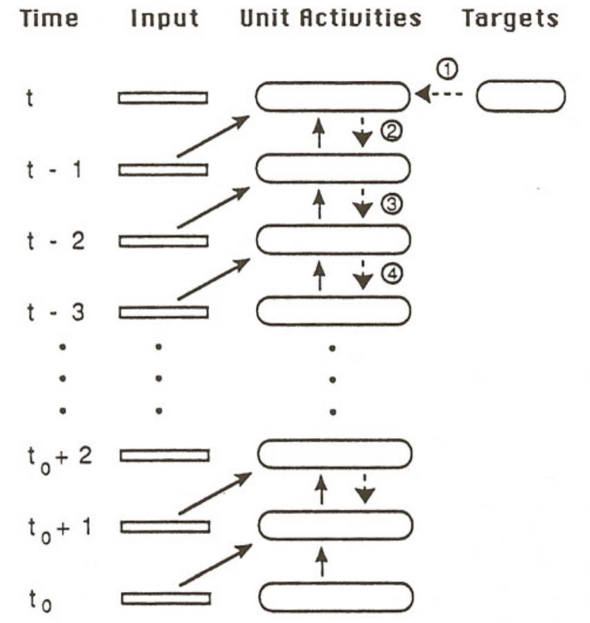
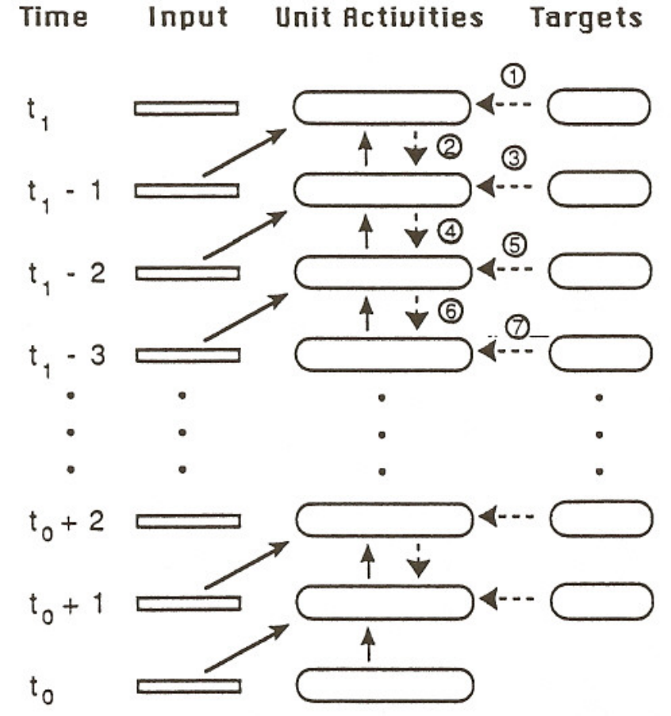
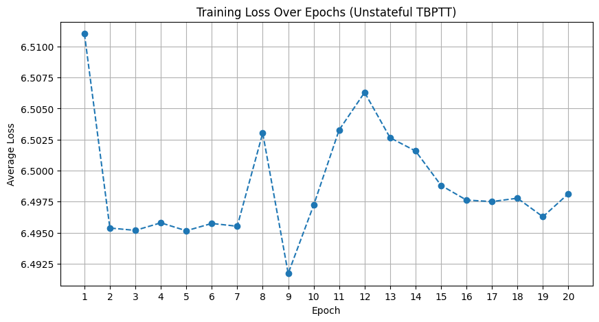
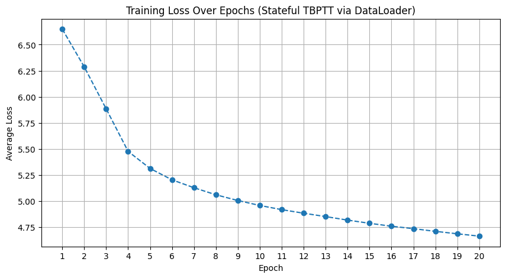
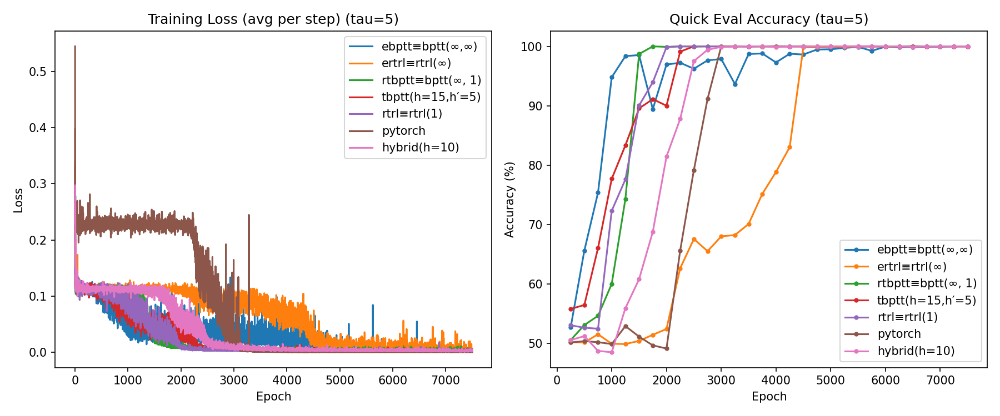
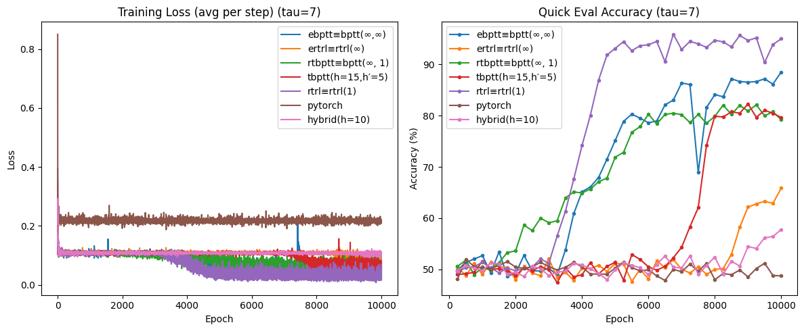
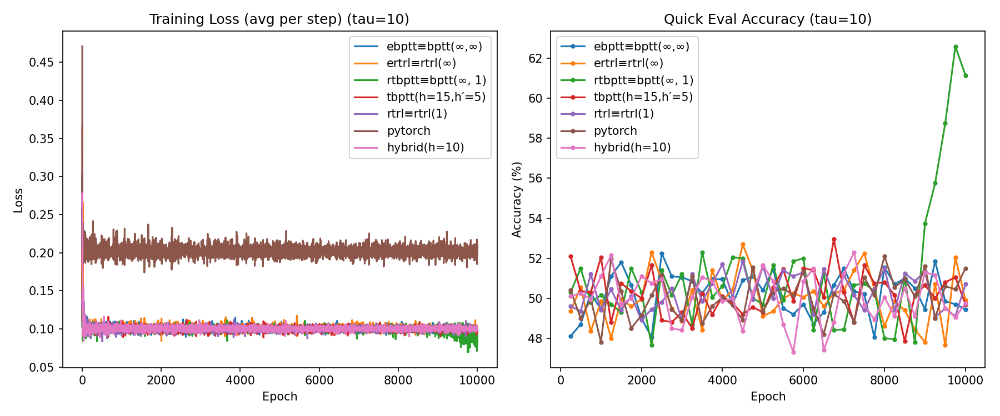

# 1.1. RNN

## Papers

- [R. J. Williams and D. Zipser, “A Learning Algorithm for Continually Running Fully Recurrent Neural Networks,” *Neural Computation*, vol. 1, no. 2, pp. 270–280, 1989.](./papers/1.1.1.pdf)
- [R. J. Williams and D. Zipser, “Gradient-Based Learning Algorithms for Recurrent Networks and Their Computational Complexity,” in *Backpropagation: Theory, Architectures, and Applications*, Y. Chauvin and D. E. Rumelhart, Eds. Hillsdale, NJ: Lawrence Erlbaum Associates, 1995, pp. 433–486.](./papers/1.1.2.pdf)

## Definitions & Forward Pass

General forward pass through the network structure is defined as follows.

!!! definition "Definition 1.1.1 : General Forward Pass"
    - **External inputs** at time $t$ : $x^{\text{in}}(t)\in\mathbb{R}^m$
    - **Unit outputs** at time $t$ : $y(t)\in\mathbb{R}^n$
    - **Augmented input vector** at time $t$ : $x(t)\in\mathbb{R}^{m+n}$

        $$
        x_k(t)= \begin{cases}x_k^{\text {in }}(t) & \text { if } k \in I \\ y_k(t) & \text { if } k \in U\end{cases}
        $$

        $x(t)$ is a concatenation of inputs $x^{\text{in}}(t)$ and outputs $y(t)$, where $U$ is the indices for $y_k(t)$, and $I$ is the indices for $x^{\text{in}}(t)$.
        We use the convention that $x_k(t)$ and $y_k(t)$ correspond to the same unit when $k\in U$.

    - **Weight matrix** : $W\in\mathbb{R}^{n\times(m+n)}$, Entry $w_{kl}$ connects $x_l(t)$ to unit $k$.
    - Pre-activation **net input** at time $t+1$ : $s(t+1)\in\mathbb{R}^n$

        $$
        \begin{equation*}
        s_{k}(t+1)=\sum_{l \in U} w_{k l} y_{l}(t)+\sum_{l \in I} w_{k l} x_{l}^{\text {in }}(t)=\sum_{l \in U \cup I} w_{k l} x_{l}(t)
        \end{equation*}
        $$
    - **Updated unit outputs** at time $t+1$ : $y(t+1)\in\mathbb{R}^n$

        $$
        \begin{equation*}
        y_{k}(t+1)=f_{k}\left(s_{k}(t+1)\right)
        \end{equation*}
        $$

$$
\underbrace{\begin{bmatrix}x^{\mathrm{in}}(t)\\y(t)\end{bmatrix}}_{x(t)}
\xrightarrow{\ W\ }s(t+1)\xrightarrow{\ f\ }y(t+1).
$$
/// caption
Figure 1.1.1 : Forward pass diagram.
///

Note that all connections are treated as having a **one-time-step delay**: inputs at time $t$ can influence outputs only at $t+1$.

Assuming our task is a sequential supervised learning task, we define the network error as follows.

!!! definition "Definition 1.1.2 : Network Error"
    - **Error for unit $k$** at time $t$ : $e_{k}(t)$

        Let $T(t)$ denote the set of indices $k \in U$ for which there exists a specified target value $d_{k}(t)$ that the output of the $k$ th unit should match at time $t$.

        $$
        e_{k}(t)= \begin{cases}d_{k}(t)-y_{k}(t) & \text { if } k \in T(t) \\ 0 & \text { otherwise }\end{cases}
        $$

    - **Negative overall network error** at time $t$ : $J(t)$
        
        $$
        \begin{equation*}
        J(t)=-\frac{1}{2} \sum_{k \in U}\left[e_{k}(t)\right]^{2}
        \end{equation*}
        $$

Our goal is to maximize the negative total error $J^{\text {total }}\left(t^{\prime}, t\right)$, 

$$
\begin{equation*}
J^{\text {total }}\left(t^{\prime}, t\right)=\sum_{\tau=t^{\prime}+1}^{t} J(\tau)
\end{equation*}
$$

One natural way to make the weight changes is along a constant positive multiple of the performance measure gradient, so that

$$
\begin{equation*}
\Delta w_{i j}=\eta \frac{\partial J^{\operatorname{total}}\left(t^{\prime}, t\right)}{\partial w_{i j}}
\end{equation*}
$$

## Gradient Computation

### Back Propagation Through Time

When we unroll the recurrent network through time, we obtain a feedforward network which has a layer for each time step.
Note that each unit and connection in the original network has a copy at each corresponding time step in the unrolled network.
The key value of this conceptualization is that it allows one to regard the problem of training a recurrent network as a corresponding problem of training a feedforward network with certain constraints imposed on its weights.

{: .center style="width:40%;"}
/// caption
Figure 1.1.2 : Unrolled recurrent network across time steps.
///

This also means that we can perform standard back propagation algorithm for feedforward nets in recurrent networks.
We introduce a general form of backpropagation through time (BPTT), $BPTT(h; h')$.
The gradient equations below assume fixed weights throughout the forward trajectory and an initial state independent of those weights.
If weights change while states or sensitivities from earlier steps are retained, the resulting online update is generally an approximation to the fixed-weight gradient.

!!! definition "Definition 1.1.3 : General Back Propagation Through Time"
    
    $$BPTT(h; h')$$

    - **Unroll length** : $h$

        When we calculate the gradient at time $t$, we retain the transitions producing outputs at times $t-h+1,\dots,t$, treating $y(t-h)$ as a fixed boundary state.
        At the beginning of a sequence, clamp this boundary to the initial time $t_0$.

        This factor controls the truncation length.
        When $h=\infty$, we maintain the full history of the network, and thus we compute the exact gradient.
        When the retained window does not reach the initial state, the gradient generally omits dependencies through the boundary state.

    - **Update period** : $h'$

        We compute the truncated gradient and update weights every $h'$ steps, with $1\le h'\le h$.

        The update objective is $J^{\text{total}}(t-h',t)=\sum_{\tau=t-h'+1}^{t}J(\tau)$.
        Recall that the first argument of $J^{\text{total}}$ is excluded from the sum.

!!! concept "Concept 1.1.4 : Base BPTT Equations"
    For a differentiable objective $F$ that depends on the outputs over $(t_0,t]$, let $g_k(\tau;F)$ be its **direct** derivative with respect to $y_k(\tau)$, treating the outputs at different times as independent arguments.
    Let $e_k(\tau;F)$ include both this direct contribution and the contribution through future recurrent states, and define

    $$
    \delta_k(\tau;F)=\frac{\partial F}{\partial s_k(\tau)}.
    $$

    They satisfy the backward recurrences (with $\tau$ stepping down from $t$ to $t_0+1$)

    $$
    e_k(\tau;F)=
    \begin{cases}
    g_k(t;F), & \tau=t, \\
    g_k(\tau;F)+\displaystyle\sum_{\ell\in U} w_{\ell k}\delta_\ell(\tau+1;F), & t_0<\tau<t.
    \end{cases}
    $$

    $$
    \delta_k(\tau;F)=f'_k\big(s_k(\tau)\big)e_k(\tau;F).
    $$

    For $F=\sum_\tau a_\tau J(\tau)$, the direct term is $g_k(\tau;F)=a_\tau e_k(\tau)$, where $e_k(\tau)$ is the target-minus-output error in **Definition 1.1.2**.
    Distinguishing direct and recurrent contributions avoids counting future losses twice.

    The weight-gradient then collects contributions from each unrolled step:

    $$
    \frac{\partial F}{\partial w_{ij}}=\sum_{\tau=t_0}^{t-1}\delta_i(\tau+1;F)x_j(\tau)
    $$

!!! concept "Concept 1.1.5 : $BPTT(h; h')$ Equations"
    At an update time $t$ (performed once every $h'$ steps), $BPTT(h; h')$:

    1. Chooses the epoch objective
    
        $$
        F = J^{\text{total}}(t-h',t)=\sum_{\tau=t-h'+1}^{t} J(\tau),
        $$

    2. Backpropagates only through the last $h$ steps, i.e. it computes **Concept 1.1.4** but restricts the recursion to $\tau\in[t-h+1,t]$ and treats $y(t-h)$ as constant.
        Only losses in $[t-h'+1,t]$ contribute direct error terms:

        $$
        e_k(\tau;J^{\text{total}})=
        \begin{cases}
        \displaystyle \frac{\partial J(t)}{\partial y_k(t)}, & \tau=t \\
        \displaystyle \frac{\partial J(\tau)}{\partial y_k(\tau)}+\sum_{\ell\in U} w_{\ell k}\delta_\ell(\tau+1;J^{\text{total}}), & t-h'+1\le \tau < t \\
        \displaystyle \sum_{\ell\in U} w_{\ell k}\delta_\ell(\tau+1;J^{\text{total}}), & t-h+1 \le \tau < t-h'+1 \\
        0, & \tau < t-h+1
        \end{cases}
        $$

        $$
        \delta_k(\tau;J^{\text{total}})=
        \begin{cases}
        f'_k\big(s_k(\tau)\big)e_k(\tau;J^{\text{total}}), & t-h+1\le\tau\le t \\
        0, & \text{otherwise}
        \end{cases}
        $$
    
    3. Uses the truncated sum:

        $$
        \frac{\partial J^{\text{total}}(t-h',t)}{\partial w_{ij}}
        \approx\sum_{\tau=t-h}^{t-1}\delta_i\big(\tau+1;J^{\text{total}}(t-h',t)\big)x_j(\tau)
        $$

        (the approximation is precisely the truncation to the interval $[t-h, t]$).
    
Thus, $BPTT(h; h')$ uses an approximate gradient of $J^{\text{total}}(t-h',t)$, backpropagating through the last $h$ time steps and injecting only the direct errors occurring in the last $h'$ time steps.

{: .center style="width:50%;"}
/// caption
Figure 1.1.3 : Truncated BPTT window over the unrolled sequence.
///

---

By controlling parameters $h$ and $h'$, we can achieve various forms of BPTT.

!!! definition "Definition 1.1.6 : Real-Time BPTT"

    $$BPTT(\infty; 1)$$

    **Real-Time BPTT** computes a gradient at every time step ($h'=1$), backpropagating through the full history ($h=\infty$).
    It is exact under the fixed-weight assumption above; its work and stored history grow with elapsed sequence length, so “real-time” does not mean constant work per step.

    {: .center style="width:40%;"}
    /// caption
    Figure 1.1.4 : Real-time BPTT with full-history backprop each step.
    ///

!!! definition "Definition 1.1.7 : Epochwise BPTT"
    
    $$BPTT(L; L),\qquad L=t_1-t_0.$$

    **Epochwise BPTT** runs forward over an interval $[t_0,t_1]$, then performs one backward pass and one weight update.
    With a fixed initial state and no intermediate weight updates, this is the exact gradient over the epoch.
    The implementation and plot legends use $BPTT(\infty,\infty)$ informally to mean “full history, update at the end of the finite epoch.”

    {: .center style="width:40%;"}
    /// caption
    Figure 1.1.5 : Epochwise BPTT backpropagating over the full sequence.
    ///

!!! definition "Definition 1.1.8 : Truncated Real-Time BPTT"
    
    $$BPTT(h; 1)$$

    **Truncated Real-Time BPTT** is the same as real-time BPTT (**Definition 1.1.6**) but backpropagates only through the last $h$ steps.

!!! definition "Definition 1.1.9 : Truncated Gradients with Epochwise Updates"
    Another convention truncates the backward path of **each** loss $J(\tau)$ to at most $h$ transitions, accumulates these approximate gradients over the epoch, and updates once at its end.
    This preserves losses throughout the epoch; backpropagating only from the final $h$ steps would discard earlier losses.
    This per-loss convention differs from the single shared history window in **Concept 1.1.5** and should not be identified with $BPTT(h;\infty)$.
    
### Real-Time Recurrent Learning

!!! definition "Definition 1.1.10 : Real-Time Recurrent Learning"
    For each $k \in U, i \in U, j \in U \cup I$, and $t_{0} \leq t \leq t_{1}$, we define

    $$
    p_{i j}^{k}(t)=\frac{\partial y_{k}(t)}{\partial w_{i j}}
    $$
    
    From the chain rule and differentiation of **Definition 1.1.1** and **Definition 1.1.2**, we find that
        
    $$
    \frac{\partial J(t)}{\partial w_{i j}}=\sum_{k \in U} e_{k}(t) p_{i j}^{k}(t)
    $$

    $$
    p_{i j}^{k}(t+1)=f_{k}^{\prime}\left(s_{k}(t+1)\right)\left[\sum_{l \in U} w_{k l} p_{i j}^{l}(t)+\delta_{i k} x_{j}(t)\right]
    $$

    with the initial condition

    $$
    p_{i j}^{k}\left(t_{0}\right)=\frac{\partial y_{k}\left(t_{0}\right)}{\partial w_{i j}}=0.
    $$
    
    The zero initial condition assumes $y(t_0)$ does not depend on the weights.
    Using this recurrence, we can compute $\frac{\partial J(t)}{\partial w_{i j}}$ online, subject to the fixed-weight qualification stated above.

Unlike back propagation through time, real time recurrent learning allows gradient computation in the same direction as the forward pass, without maintaining specific history of the network.

For a dense network with $m=O(n)$, maintaining $p_{i j}^{k}(t)$ requires $\Theta(n^3)$ space and $\Theta(n^4)$ time per step.
The 1995 paper's exact hybrid algorithm, $FP/BPTT(h)$, uses $\Theta(n^3+nh)$ space and $\Theta(n^3+n^4/h)$ amortized time per step.
Choosing $h=\Theta(n)$ gives $\Theta(n^3)$ time per step, improving on RTRL's $\Theta(n^4)$ bound.
These bounds are for the dense, fully trainable network; they do not give a general $\Theta(n^2)$ exact algorithm.

## Teacher Forcing

!!! definition "Definition 1.1.11 : Teacher Forcing"
    During **teacher forced** training, whenever a target exists for unit $k$ at time $t$ (i.e., $k\in T(t)$), the network feeds the target back in place of the unit’s own output for all subsequent computations at that time step.

    $$
    x_k(t)=
    \begin{cases}
    x^{\text{in}}_k(t), & k\in I,\\
    d_k(t), & k\in T(t),\\
    y_k(t), & k\in U\setminus T(t).
    \end{cases}
    $$

In BPTT, we cut off the error flow from future time steps into the teacher-forced node and use only the direct loss term at that step.
Thus **Concept 1.1.5** changes to

$$
e_k(\tau;F)=g_k(\tau;F), \quad k \in T(\tau).
$$

For $F=J^{\text{total}}(t-h',t)$, this direct term is $d_k(\tau)-y_k(\tau)$ when $t-h'+1\le\tau\le t$, and zero outside that loss interval.
The loss still uses the model's output; only the value fed back into the recurrence is replaced by the target.

In RTRL, we treat the value of $p_{i j}^{l}(t)$ as zero for any $l \in T(t)$ when computing $p_{i j}^{k}(t +1)$ via **Definition 1.1.10**.

$$
\begin{equation*}
p_{i j}^{k}(t+1)=f_{k}^{\prime}\left(s_{k}(t+1)\right)\left[\sum_{l \in U \backslash T(t)} w_{k l} p_{i j}^{l}(t)+\delta_{i k} x_{j}(t)\right]
\end{equation*}
$$

!!! concept "Concept 1.1.12 : Pros and Cons of Teacher Forcing"
    **Pros**

    - Speeds up and stabilizes training (less compounding of self-generated errors).
    - Keeps trajectories on-target in continual/oscillatory tasks (helps learn correct phase/dynamics).
    - Efficient in continually operating nets, since teacher forcing injects truth states to keep trajectories on track, so gradients carry the right information.

    **Cons**

    - Train/test mismatch: model is fed ground truth during training but not at inference → weaker free-running behavior (“exposure bias”).
    - Can mask error-recovery skills (model learns less about fixing its own mistakes).
    - Cuts some gradient paths (through forced units), which can under-train long temporal dependencies if overused.


## Implementation

### 1. PTB Dataset Prediction with RNN

<div style="text-align:center" markdown>
[Link to Code](https://github.com/arnold518/ai-study/tree/main/paper-review/1/1)
</div>

!!! definition "Definition 1.1.13 : PyTorch RNN"
    
    <div style="text-align:center" markdown>
    [PyTorch RNN Reference](https://docs.pytorch.org/docs/stable/generated/torch.nn.RNN.html)
    </div>

    $$
    h_t = \tanh (x_t W_{ih}^T + b_{ih} + h_{t-1} W_{hh}^T + b_{hh})
    $$

    Here $h_{t-1}$ is the previous time step's hidden state in the **same recurrent layer**.
    In a stacked RNN, higher layers receive the preceding layer's output at the current time as their input.
    The shapes below assume batched input, `batch_first=False`, and `bidirectional=False`.

    Parameters :

    - `input_size` : $H_{in}$, the dimension of input $x_t$.
    - `hidden_size` : $H_{out}$, the dimension of hidden state $h_t$.
    - `num_layers` : $K$, the number of recurrent layers, setting 2 layers means stacking two RNNs together to form a stacked RNN, with the second RNN taking the outputs of the first RNN and computing the final results.

    Other parameters (given when inputs are given) : 

    - `sequence_length` : $L$, the sequence length of input $x_t$.
    - `batch_size` : $N$, the batch size of input.

    Inputs : 
    
    - `input` : $x_t$, tensor of shape $(L, N, H_{in})$ containing the features of the input sequence.
    - `hx` : $h_0$, tensor of shape $(K, N, H_{out})$, containing the initial hidden state. It defaults to zeros if omitted.

    Outputs : 

    - `output` : $h_t$, tensor of shape $(L, N, H_{out})$ containing the output features from the last layer of the RNN, for each $t$.
    - `h_n` : $h_L$, tensor of shape $(K, N, H_{out})$ containing the final hidden state for each element in the batch.

    Variables :

    - `weight_ih_l[k]` : input-hidden weights of the $k$th layer, of shape $(H_{out}, H_{in})$ for $k=0$, $(H_{out}, H_{out})$ for $k>0$.
    - `weight_hh_l[k]` : hidden-hidden weights of the $k$th layer, of shape $(H_{out}, H_{out})$.
    - `bias_ih_l[k]` : input-hidden bias of the $k$th layer, of shape $(H_{out})$.
    - `bias_hh_l[k]` : hidden-hidden bias of the $k$th layer, of shape $(H_{out})$.

In order to predict the next word in the PTB dataset with RNN, we constructed an `embedding - rnn - linear` structured model.
First, we transformed each word into a feature vector using the embedding layer.
After passing the sequence of feature vectors through the RNN, a linear layer produces vocabulary logits.
Softmax converts these logits to next-word probabilities.
For training, PyTorch's cross-entropy loss takes the logits directly and applies log-softmax internally.

``` py
# --- 4. RNN Model ---
class RNNModel(nn.Module):
    """Minimal RNN LM: Embedding → RNN → Linear-to-Vocab.
    
    Forward expects:
      tokens : [sequence_length, batch_size]
      h_0    : [num_layers,     batch_size, hidden_size] or None
    Returns:
      logits : [sequence_length, batch_size, vocab_size]
      h_N    : [num_layers,     batch_size, hidden_size]
    """
    def __init__(self, dict_size, embedding_size, hidden_size, num_layers):
        super().__init__()
        self.embedding = nn.Embedding(dict_size, embedding_size)
        self.rnn = nn.RNN(embedding_size, hidden_size, num_layers=num_layers)
        self.linear = nn.Linear(hidden_size, dict_size)

    def forward(self, x, h):
        """
        tokens   : [sequence_length, batch_size]
        h        : [num_layers, batch_size, hidden_size]
        embedded : [sequence_length, batch_size, embedding_size]
        out      : [sequence_length, batch_size, hidden_size]
        logits   : [sequence_length, batch_size, vocab_size]
        """
        emb = self.embedding(x)            # [seq_len, B, E]
        out, h = self.rnn(emb, h)          # out: [seq_len, B, H]
        logits = self.linear(out)          # [seq_len, B, V]
        return logits, h
```

!!! code "Code 1.1.1.1 : Stateless Training on Truncated Windows using PyTorch RNN"
    Source file: `1.1.1.py`.

    ``` py
    # --- 3. Dataset Class ---
    class PTBSequenceDataset:
        """Slice a long 1D corpus into (input, target) pairs of fixed sequence length."""
        def __init__(self, corpus, sequence_length):
            self.corpus = corpus
            self.seq_len = sequence_length

        def __len__(self):
            return len(self.corpus) - self.seq_len

        def __getitem__(self, idx):
            inputs = self.corpus[idx : idx + self.seq_len]
            targets = self.corpus[idx + 1 : idx + self.seq_len + 1]
            return inputs, targets

    # --- 5. Setup ---
    sequence_length = 35

    train_set = PTBSequenceDataset(train_corpus[:100000], sequence_length)
    test_set = PTBSequenceDataset(test_corpus, sequence_length)

    train_loader = DataLoader(train_set, batch_size=batch_size, shuffle=True)
    test_loader = DataLoader(test_set, batch_size=batch_size, shuffle=False)
    ```

    This dataset creates overlapping windows of length $L$, one for every valid starting position, and shuffles them for training.
    Each window starts with a zero hidden state, so the model has at most $L$ input tokens of context within that window.
    This is stateless training on truncated windows, rather than stateful $BPTT(L;L)$ on consecutive chunks of one stream.

    The original run reported 5.31% test accuracy.
    However, the linked training and evaluation-loss code transpose inputs from $[B,L]$ to $[L,B]$ while leaving targets in $[B,L]$ order before flattening them.
    This pairs most logits with the wrong labels. Both tensors must use the same ordering:

    ``` py
    # DataLoader returns inputs and targets with shape [B, L].
    inputs = inputs.to(device).t().contiguous()
    targets = targets.to(device).t().contiguous()
    logits, _ = model(inputs, None)  # Zero initial hidden state.
    loss = criterion(logits.reshape(-1, dict_size), targets.reshape(-1))
    ```

    Apply the same target alignment when computing evaluation loss.
    The existing accuracy function already aligns predictions with targets by transposing predictions back to $[B,L]$; preserve that consistency if changing target layout.
    The low accuracy is therefore not evidence that stateless training cannot learn; a corrected run is needed for a fair comparison.

    {: .center style="width:100%;"}
    /// caption
    Figure 1.1.6 : Original stateless training curve, affected by the target-ordering bug.
    ///

!!! code "Code 1.1.1.2 : Stateful TBPTT with PyTorch RNN"
    Source file: `1.1.2.py`.

    
    ``` py
    # --- 3) Stream batching into [T, B] ---
    def batchify(data_1d, batch_size, device):
        """
        Reshape a 1D token stream into [T, B] where B=batch_size parallel streams.
        Trims the tail so T*B divides the length exactly.
        """
        n_batches = data_1d.size(0) // batch_size
        data_1d = data_1d.narrow(0, 0, n_batches * batch_size)
        data_tb = data_1d.view(batch_size, -1).t().contiguous()  # [T, B]
        return data_tb.to(device)

    # --- 4) TBPTT windowing via IterableDataset (stateful order preserved) ---
    class StreamBatchDataset(IterableDataset):
        """
        Iterates over a time-major source tensor [T, batch_size] and yields
        (data_window, target_window) pairs for TBPTT:
        data_window   : [seq_len, batch_size]
        target_window : [seq_len * batch_size]  (flattened next-token labels)
        NOTE: Order is sequential; do NOT shuffle if you want stateful training.
        """
        def __init__(self, source_tb: torch.Tensor, sequence_length: int):
            super().__init__()
            self.source = source_tb
            self.seq_len = sequence_length

        def __iter__(self):
            T = self.source.size(0)
            for i in range(0, T - 1, self.seq_len):
                cur_len = min(self.seq_len, (T - 1) - i)
                data = self.source[i : i + cur_len]                   # [cur_len, B]
                target = self.source[i + 1 : i + 1 + cur_len]         # [cur_len, B]
                yield data, target.reshape(-1)                         # [cur_len*B]

    # --- 6) Hyperparameters & tensors ---
    sequence_length = 35
    # Create iterable datasets that yield TBPTT windows sequentially
    train_ds = StreamBatchDataset(train_tb, sequence_length)
    test_ds  = StreamBatchDataset(test_tb,  sequence_length)

    # DataLoaders: keep order, no auto-batching (each dataset item is already a batch window)
    # num_workers=0 is safest when source tensors live on GPU
    train_loader = DataLoader(train_ds, batch_size=None, shuffle=False, num_workers=0)
    test_loader  = DataLoader(test_ds,  batch_size=None, shuffle=False, num_workers=0)
    ```

    For stateful training, we used iterable datasets.
    First, split the corpus into $N$ parallel contiguous streams.
    Then, take consecutive windows of length $L$ from each stream, carrying each stream's hidden state to its next window.

    For stateful TBPTT, retain hidden-state values across windows but detach their computation graph before the next window (`hidden = hidden.detach()`).
    Reset the state when starting an independent sequence or a new pass through the corpus.
    Forward context can therefore extend beyond $L$ steps even though gradients stop at each window boundary.

    This run reported 23.66% final test accuracy.
    It also uses a different training-data setup from the 100,000-token subset in **Code 1.1.1.1**, so these runs do not isolate the effect of carrying hidden state.

    {: .center style="width:100%;"}
    /// caption
    Figure 1.1.7 : Stateful TBPTT training curve with improved accuracy.
    ///

!!! code "Code 1.1.1.3 : Handmade RNN"
    Source file: `1.1.3.py`.

    Replaced the PyTorch RNN with custom implementations of `class MinimalRNNCell(nn.Module)` and `class MinimalRNN(nn.Module)`.

    Showed almost the same results as **Code 1.1.1.2**

### 2. Solving Delayed XOR Task with Various RNN Algorithms

<div style="text-align:center" markdown>
[Link to Code](https://github.com/arnold518/ai-study/tree/main/paper-review/1/2)
</div>

The paper labels the output produced from input $x^{\mathrm{in}}(t)$ as $y(t+1)$, while PyTorch labels the output produced from $x_t$ as $h_t$.
For a single recurrent layer, these are equivalent recurrences after relabeling time; this is not an extra computational delay in one implementation.
The following convention makes the input/output and target alignment explicit.

!!! definition "Definition 1.1.14 : Universal Forward Pass Convention"
    Paper (**Definition 1.1.1**, **Definition 1.1.2**)

    - Forward pass : 
        $x(t) = [x^{\text{in}}(t), y(t)], s(t+1)=Wx(t), y(t+1)=f(s(t+1))$
    - Supervision (targets) :
        At time step $t$, we supervise the output $y(t+1)$, produced after consuming $x(t)$, with target $d(t+1)$.

    PyTorch (**Definition 1.1.13**)

    - Forward pass :
        $h_t= \text{RNN}(x_t, h_{t-1})$
    - Supervision (targets) :
        At timestep $t$, we supervise $h_t$, which was produced after consuming $x_t$.
    - Alignment to the paper :
        Identify $h_t \equiv y(t+1), x_t \equiv x^{\text{in}}(t)$

    **Universal Convention**

    - Forward pass :
        `x_list[t]` $\equiv x(t)$, `s_list[t]` $\equiv s(t+1)$, `y_list[t]`$\equiv y(t+1)$  
        ($x(t), s(t+1), y(t+1)$ is defined as the paper)
    - Supervision (targets) : 
        `D[t]` $\equiv d(t+1)$, At timestep $t$, we compare `y_list[t]` to `D[t]`, i.e. $y(t+1)$ to $d(t+1)$.

    <div style="text-align:center" markdown>

    | Concept                  | Paper               | PyTorch           | Universal Convention           |
    | ------------------------ | ------------------- | ----------------- | ------------------------------ |
    | External input used      | $x^{\text{in}}(t)$  | `input[t]`$=x_t$  | `x_list[t][:m]`                |
    | Concatenated input       | $x(t)$              | — (implicit)     | `x_list[t] = [x_in(t), y(t)]` |
    | Pre-activation           | $s(t+1)$            | — (inside cell)  | `s_list[t]`                    |
    | Output/hidden            | $y(t+1)$            | `output[t]`$=h_t$ | `y_list[t] = x_list[t+1][m:]`                    |
    | Previous state           | $y(t)$              | `output[t-1]`$=h_{t-1}$ | `x_list[t][m:]`      |
    | Target at timestep $t$   | $d(t+1)$            | `answer[t]`       | `D[t]`                         |

    </div>


Using the universal forward pass convention (**Definition 1.1.14**), we implemented and compared various algorithms of gradient computation in RNNs.
We tackled delayed XOR: `D[t + tau]` is the XOR of the two bits in `X[t]`.
Under the universal convention, `D[t + tau]` supervises `y_list[t + tau]`, which is the paper's $y(t+\tau+1)$.
Thus $\tau$ is a delay in array indices; the paper's output-time label includes the extra $+1$.

!!! code "Code 1.1.2"
    - `alg_pytorch.py` : 
        Used a single layer PyTorch RNN module described in **Definition 1.1.13**, modified to match **Definition 1.1.14**.
    - `alg_bptt.py` : 
        The linked implementation truncates each supervised output's backward path separately to $h$ transitions and updates every $h'$ steps.
        When $h'>1$, this differs from **Concept 1.1.5**: earlier losses in an update can reach further back than the single shared boundary $t-h$.
        Its plot label "tbptt" should be read with this implementation-specific convention.

        - ebptt $\equiv BPTT(\infty, \infty)$ : Epochwise BPTT defined in **Definition 1.1.7**.
        - rtbptt $\equiv BPTT(\infty, 1)$ : Real-Time BPTT defined in **Definition 1.1.6**.
        - tbptt : per-loss truncation to $h$ transitions, with an update every $h'$ steps.
    - `alg_rtrl.py` : 
        Implemented RTRL described in **Definition 1.1.10**.
        For analogy with BPTT, introduced $RTRL(h')$, where we update the weights every $h'$ timesteps.

        - ertrl $\equiv RTRL(\infty)$ : Epochwise RTRL, accumulate gradients and update weights after consuming an epoch.
        - rtrl $\equiv RTRL(1)$ : update weights every time step.
    - `alg_hybrid.py` : 
        The linked prototype computes bucket-local BPTT gradients and maintains boundary sensitivities.
        However, its weight update does not use those sensitivities to add the gradient contribution through the bucket's initial state.
        The plotted "hybrid" result therefore represents this incomplete prototype, not the paper's exact $FP/BPTT(h)$ algorithm.
    - `core.py` :
        File for dataclass definitions.
    - `helper.py` : 
        File containing activation functions, their derivatives, delayed xor testbench, and scorers.
    - `main.py` : 
        Main runner file, controls parameters, creates testdata, and runs the test on all algorithms.
    
    One example configuration is shown below. The figures use different values of $\tau$; Figures 1.1.9 and 1.1.10 also run for 10,000 epochs rather than the 7,500 shown here.

    ``` py
    results = run_many(
        alg_names=["ebptt", "ertrl", "rtbptt", "tbptt", "rtrl", "pytorch", "hybrid"],
        m=2, n=8, lr=5e-3,
        tau=7, Ttrain=50, Teval=50,
        eval_seqs=200, quick_eval_seqs=50,
        epochs=7500, log_every=250,
        weight_decay=0.0,
        truncation_h=15, update_every_hprime=5,   # used only by tbptt
        rtrl_hprime=1,                            # used only by rtrl (continual)
        h_bucket=10,                              # used only by hybrid
        grad_clip=None,
        seed=0,
        metric_name="acc", metric_threshold=0.5,
    )
    ```

{: .center style="width:100%;"}
/// caption
Figure 1.1.8 : Delayed XOR accuracy at tau=5.
///

{: .center style="width:100%;"}
/// caption
Figure 1.1.9 : Delayed XOR accuracy at tau=7.
///

{: .center style="width:100%;"}
/// caption
Figure 1.1.10 : Delayed XOR accuracy at tau=10.
///

In these runs, all plotted implementations approached 100% quick-evaluation accuracy at $\tau=5$, while learning generally became harder at larger delays.
At $\tau=10$, most curves stayed near the 50% chance level, although real-time BPTT rose above 60% near the end.

These observations concern this small RNN, its hyperparameters, and these implementations, including the prototype limitations above.
They do not establish a fixed memory limit for all RNNs or a controlled ranking of exact gradient algorithms.
LSTMs and GRUs introduce gating mechanisms that can make learning longer dependencies easier, but do not guarantee success on every long-delay task.
