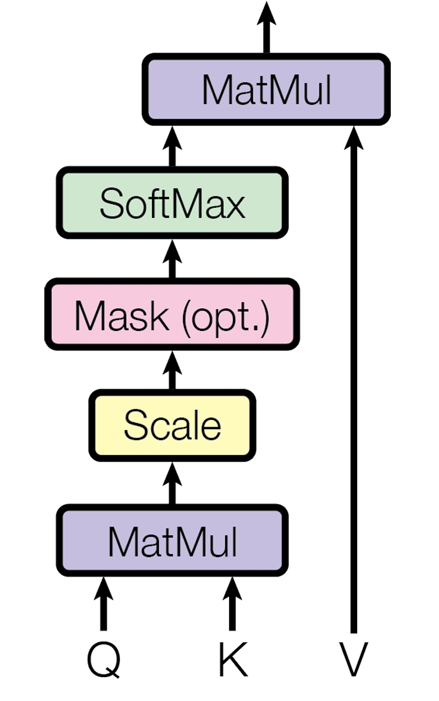
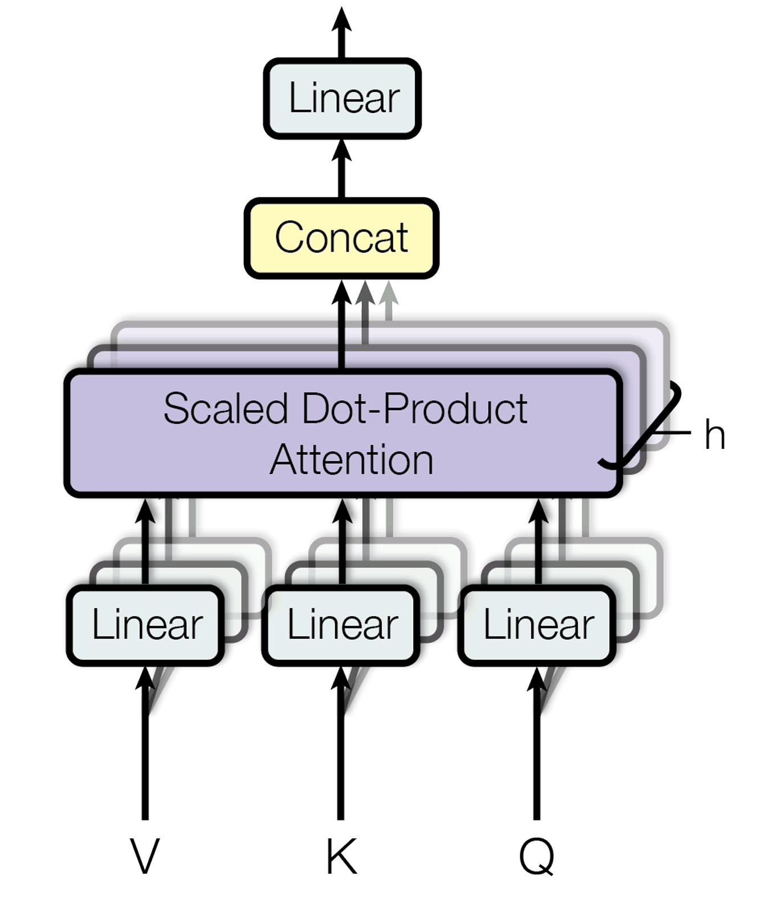
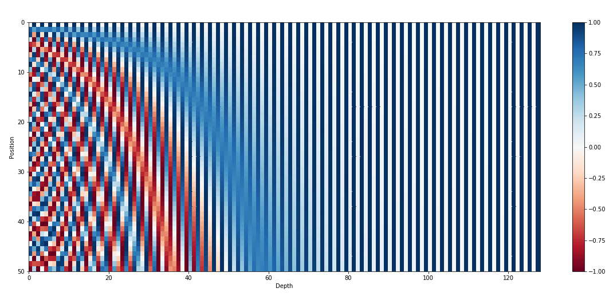
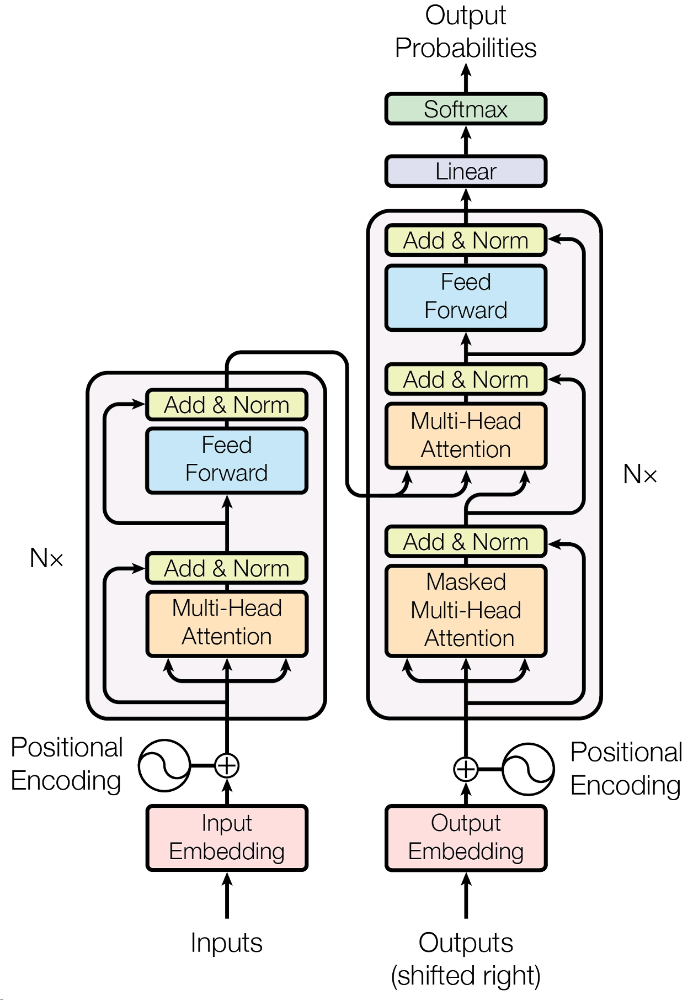
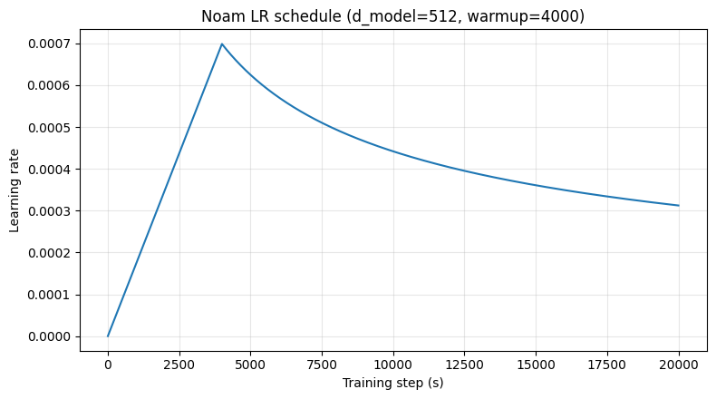
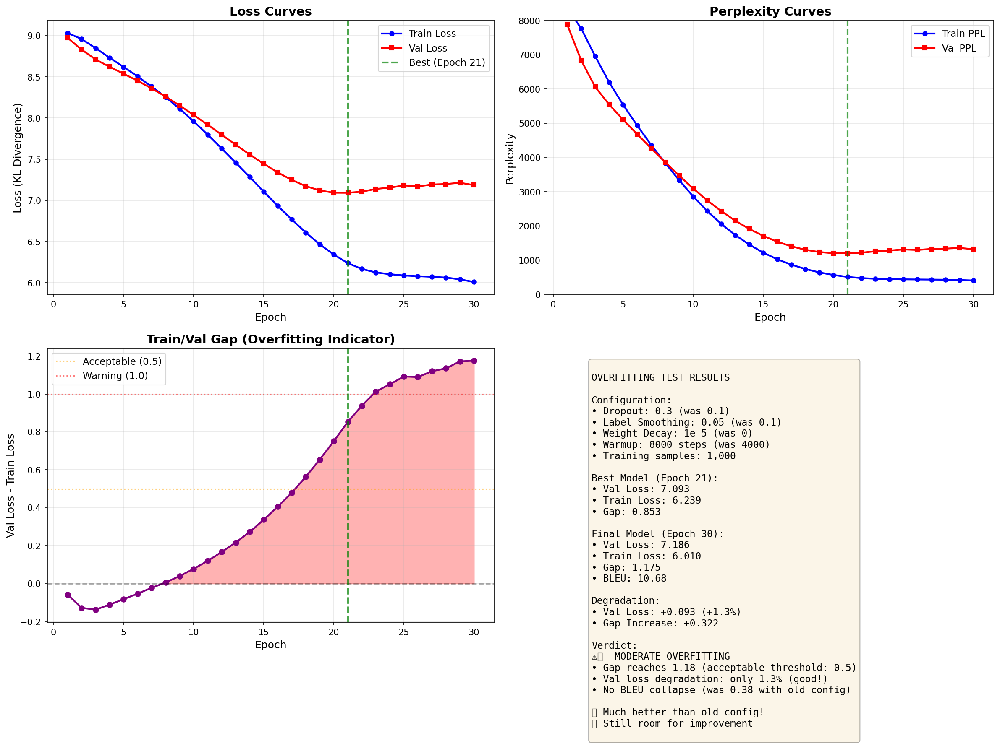
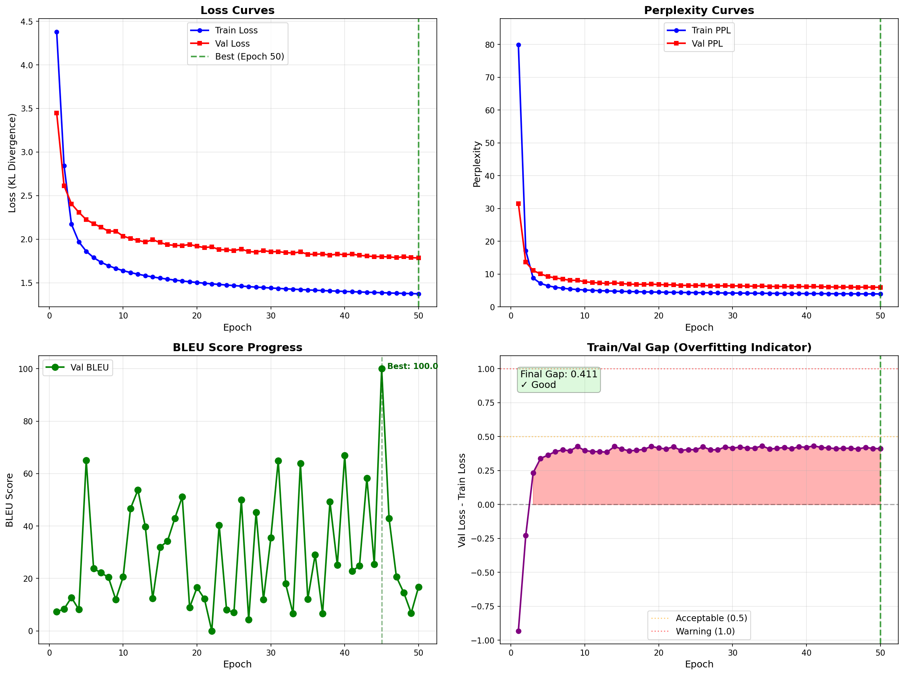
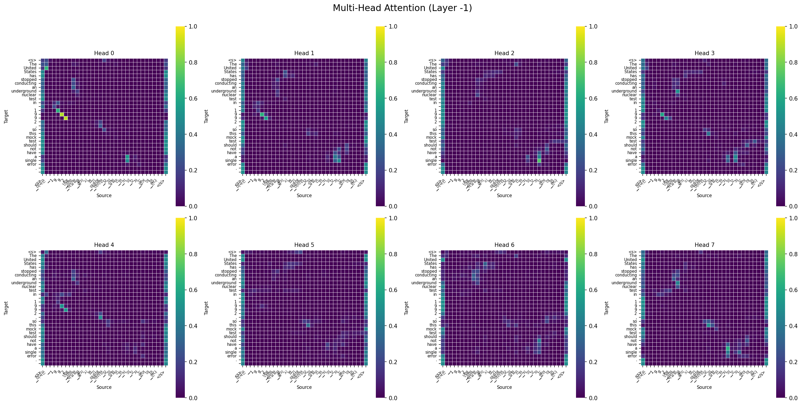

# 1.5. Transformer

## Papers

- [A. Vaswani, N. Shazeer, N. Parmar, J. Uszkoreit, L. Jones, A. N. Gomez, Ł. Kaiser, and I. Polosukhin, “Attention Is All You Need,” in *Advances in Neural Information Processing Systems 30 (NIPS 2017)*, 2017, pp. 5998–6008.](./papers/1.5.1.pdf)

## Blogs

- [https://jalammar.github.io/illustrated-transformer/](https://jalammar.github.io/illustrated-transformer/)
- [https://kazemnejad.com/blog/transformer_architecture_positional_encoding/](https://kazemnejad.com/blog/transformer_architecture_positional_encoding/)
- [https://nlp.seas.harvard.edu/annotated-transformer/](https://nlp.seas.harvard.edu/annotated-transformer/)

## Core Components

### Scaled Dot-Product Attention

Attention compares query vectors with key vectors and returns weighted sums of the corresponding value vectors.
In self-attention, queries, keys, and values come from the same sequence; in cross-attention, queries come from one sequence and keys/values from another.

!!! definition "Definition 1.5.1 : Scaled Dot-Product Attention"
    - **Input Queries** from $S_1$ :  
        From the first sequence $S_1$, query vectors for each word are given as input.

        $$
        q_1, q_2, \dots, q_{|S_1|} \in \mathbb{R}^{d_k}.
        $$
    
    - **Input Key-Value pairs** from $S_2$ :  
        From the second sequence $S_2$, key-value vector pairs for each word are given as input.

        $$
        k_1, k_2, \dots, k_{|S_2|} \in \mathbb{R}^{d_k}.
        $$

        $$
        v_1, v_2, \dots, v_{|S_2|} \in \mathbb{R}^{d_v}.
        $$

    - **Score** (relation) of word $S_{1, i}$ and $S_{2, j}$ :  
        For each $1 \le i \le |S_1|$, $1 \le j \le |S_2|$, we compute the dot-product attention as the dot product between the query vector $q_i$ and key vector $k_j$.
        This value represents the score (relation) of word $S_{1, i}$ and $S_{2, j}$.

        $$
        s(i, j) = q_i \cdot k_j.
        $$

    - **Masking** (Optional) :  
        If we want to **ignore** the relation between specific pair of words, we can apply masking by zeroing out the softmax probability with explicitly setting

        $$
        s(i, j) = -\infty.
        $$

        Causal masking is used in **Definition 1.5.9**; padding masks also exclude padding positions.
        Each valid query must retain at least one unmasked key for softmax to be well-defined.
    
    - **Output** :  
        For each fixed $i$, define the score vector over all positions in $S_2$:

        $$
        s_i
        =
        \big(s(i,1), s(i,2), \dots, s(i,|S_2|)\big)
        \in
        \mathbb{R}^{|S_2|}.
        $$

        We scale by $\sqrt{d_k}$ and take softmax to get attention weights:

        $$
        \alpha_{i,j}
        =
        \frac{\exp\!\left(\frac{s(i,j)}{\sqrt{d_k}}\right)}
            {\sum_{t=1}^{|S_2|}\exp\!\left(\frac{s(i,t)}{\sqrt{d_k}}\right)}
        \qquad
        (1 \le j \le |S_2|).
        $$

        Then the output (context) vector for token $S_{1,i}$ is the weighted average of the values:

        $$
        o_i
        =
        \sum_{j=1}^{|S_2|} \alpha_{i,j}\, v_j
        \in
        \mathbb{R}^{d_v}.
        $$

        Collecting all outputs gives:

        $$
        o_1, o_2, \dots, o_{|S_1|}
        \in
        \mathbb{R}^{d_v}.
        $$
    
    - **Matrix form** :  
        Define the stacked matrices by putting the vectors as rows:

        $$
        Q
        =
        \begin{bmatrix}
        q_1^\top \\
        q_2^\top \\
        \vdots \\
        q_{|S_1|}^\top
        \end{bmatrix}
        \in \mathbb{R}^{|S_1|\times d_k},
        \qquad
        K
        =
        \begin{bmatrix}
        k_1^\top \\
        k_2^\top \\
        \vdots \\
        k_{|S_2|}^\top
        \end{bmatrix}
        \in \mathbb{R}^{|S_2|\times d_k},
        \qquad
        V
        =
        \begin{bmatrix}
        v_1^\top \\
        v_2^\top \\
        \vdots \\
        v_{|S_2|}^\top
        \end{bmatrix}
        \in \mathbb{R}^{|S_2|\times d_v}.
        $$


        $$
        \mathrm{Attention}(Q,K,V)
        =
        \mathrm{softmax}\!\left(\frac{QK^\top}{\sqrt{d_k}}\right)V
        = 
        \begin{bmatrix}
        o_1^\top \\
        o_2^\top \\
        \vdots \\
        o_{|S_1|}^\top
        \end{bmatrix} \in \mathbb{R}^{|S_1|\times d_v}.
        $$

Among the commonly used additive attention and dot-product (multiplicative) attention, the paper chose dot-product attention, with a scaling factor of $\frac{1}{\sqrt{d_k}}$.
The scaling factor was introduced to normalize the dot-product, which grows bigger for larger values of $d_k$, which will push the softmax function into regions where the gradients vanish.
(Modeling the components of $q_i$ and $k_j$ as i.i.d. random variables of mean $0$ and variance $1$ gives $s(i, j) = q_i \cdot k_j$ variance of $d_k$, so we have to normalize by the scaling factor of $\frac{1}{\sqrt{d_k}}$.)

{: .center style="width:30%;"}
/// caption
Figure 1.5.1 : Scaled dot-product attention.
///

### Multi-Head Attention

Instead of using just one attention, we project the query, key, value vectors to $h$ multiple heads and perform attention function on each of them in parallel.
The outputs of the heads are concatenated and projected to obtain the final representations.

!!! definition "Definition 1.5.2 : Multi-Head Attention"
    - **Input** :  
        Queries, keys, and values for each token are given as vectors of dimension $d_{\mathrm{model}}$.

        $$
        Q \in \mathbb{R}^{|S_1|\times d_{\mathrm{model}}}, \quad
        K \in \mathbb{R}^{|S_2|\times d_{\mathrm{model}}}, \quad
        V \in \mathbb{R}^{|S_2|\times d_{\mathrm{model}}}.
        $$
    
    - For each head, $Q, K, V$ are projected to dimensions $d_k, d_k, d_v$ by learned linear projections $W_i^Q, W_i^K, W_i^V$.
        Then, the attention function is computed for each set of projected queries, keys, and values.

        $$
        W_i^Q \in \mathbb{R}^{d_{\mathrm{model}} \times d_k}, \quad
        W_i^K \in \mathbb{R}^{d_{\mathrm{model}} \times d_k}, \quad
        W_i^V \in \mathbb{R}^{d_{\mathrm{model}} \times d_v}.
        $$
        
        $$
        \mathrm{head}_i = \mathrm{Attention}(QW_i^Q, KW_i^K, VW_i^V) \in \mathbb{R}^{|S_1| \times d_v}.
        $$

    - **Output** :  
        For each token, the results $\mathrm{head}_i$ are concatenated, and projected again to output a vector of dimension $d_{\mathrm{model}}$ by learned projection $W^O$.
        Equivalently, partition $W^O$ into one block per head, project each head with its corresponding block, and sum those projected outputs.

        $$
        W^O \in \mathbb{R}^{hd_v \times d_{\mathrm{model}}}.
        $$

        $$
        \mathrm{MultiHead}(Q, K, V) = 
        \mathrm{Concat}(\mathrm{head}_1, \dots, \mathrm{head}_h) W^O
        \in \mathbb{R}^{|S_1| \times d_{\mathrm{model}}}.
        $$

{: .center style="width:50%;"}
/// caption
Figure 1.5.2 : Multi-head attention.
///

### Position-wise Feed-Forward Network

Attention mixes information across positions, while the feed-forward network applies a nonlinear transformation to each position's contextual representation.
Its parameters are shared across positions within a layer, but differ between layers.

!!! definition "Definition 1.5.3 : Position-wise Feed-Forward Network"
    - **Input** :  
        Representations of the tokens are given as vectors of dimension $d_{\mathrm{model}}$.

        $$
        x \in \mathbb{R}^{|S|\times d_{\mathrm{model}}}.
        $$

    - **Output** :  
        Each vector passes through two linear transformations with a ReLU activation in between.
        Note that each token is passed through the feed-forward network independently.

        $$
        W_1 \in \mathbb{R}^{d_{\mathrm{model}} \times d_{ff}}, \quad
        b_1 \in \mathbb{R}^{d_{ff}}, \quad
        W_2 \in \mathbb{R}^{d_{ff} \times d_{\mathrm{model}}}, \quad
        b_2 \in \mathbb{R}^{d_{\mathrm{model}}}.
        $$

        $$
        \mathrm{FFN}(x) = \max(0, xW_1+b_1)W_2+b_2
        \in \mathbb{R}^{|S| \times d_{\mathrm{model}}}.
        $$

### Positional Encoding

Without positional information or position-dependent masks, self-attention is permutation-equivariant and does not distinguish token order.
Positional encoding is added to the input embeddings at the beginning to give the model information about the order.

!!! definition "Definition 1.5.4 : Positional Encoding"
    $$
    \mathrm{PE} \in \mathbb{R}^{|S| \times d_{\mathrm{model}}}
    $$

    $$
    \omega_i = \frac{1}{10000^{2i / d_{\mathrm{model}}}}, \quad
    \mathrm{PE}_{pos, 2i} = \sin(pos \cdot \omega_i),
    \quad
    \mathrm{PE}_{pos, 2i+1} = \cos(pos \cdot \omega_i).
    $$

    For even $d_{\mathrm{model}}$, use $i=0,\dots,d_{\mathrm{model}}/2-1$.
    Each sine/cosine pair has wavelength $2\pi\,10000^{2i/d_{\mathrm{model}}}$, forming a geometric progression from $2\pi$ to just below $10000\cdot2\pi$.

{: .center style="width:100%;"}
/// caption
Figure 1.5.3 : Visualization of sinusoid positional encoding.
///

!!! concept "Concept 1.5.5 : Intuitions behind Choice of Positional Encoding Function"
    
    - 
        The binary representation of positions gives us a discrete (0/1) version of a positional encoding function: each bit is a separate “channel” that flips at its own rate.
        The least-significant bit changes every step (period 2), the next bit changes every two steps (period 4), then every four steps (period 8), and so on.

        $$
        \begin{align}
        0: \ \ \ \ \color{orange}{\texttt{0}} \ \ \color{green}{\texttt{0}} \ \ \color{blue}{\texttt{0}} \ \ \color{red}{\texttt{0}} & & 
        8: \ \ \ \ \color{orange}{\texttt{1}} \ \ \color{green}{\texttt{0}} \ \ \color{blue}{\texttt{0}} \ \ \color{red}{\texttt{0}} \\
        1: \ \ \ \ \color{orange}{\texttt{0}} \ \ \color{green}{\texttt{0}} \ \ \color{blue}{\texttt{0}} \ \ \color{red}{\texttt{1}} & & 
        9: \ \ \ \ \color{orange}{\texttt{1}} \ \ \color{green}{\texttt{0}} \ \ \color{blue}{\texttt{0}} \ \ \color{red}{\texttt{1}} \\ 
        2: \ \ \ \ \color{orange}{\texttt{0}} \ \ \color{green}{\texttt{0}} \ \ \color{blue}{\texttt{1}} \ \ \color{red}{\texttt{0}} & & 
        10: \ \ \ \ \color{orange}{\texttt{1}} \ \ \color{green}{\texttt{0}} \ \ \color{blue}{\texttt{1}} \ \ \color{red}{\texttt{0}} \\ 
        3: \ \ \ \ \color{orange}{\texttt{0}} \ \ \color{green}{\texttt{0}} \ \ \color{blue}{\texttt{1}} \ \ \color{red}{\texttt{1}} & & 
        11: \ \ \ \ \color{orange}{\texttt{1}} \ \ \color{green}{\texttt{0}} \ \ \color{blue}{\texttt{1}} \ \ \color{red}{\texttt{1}} \\ 
        4: \ \ \ \ \color{orange}{\texttt{0}} \ \ \color{green}{\texttt{1}} \ \ \color{blue}{\texttt{0}} \ \ \color{red}{\texttt{0}} & & 
        12: \ \ \ \ \color{orange}{\texttt{1}} \ \ \color{green}{\texttt{1}} \ \ \color{blue}{\texttt{0}} \ \ \color{red}{\texttt{0}} \\
        5: \ \ \ \ \color{orange}{\texttt{0}} \ \ \color{green}{\texttt{1}} \ \ \color{blue}{\texttt{0}} \ \ \color{red}{\texttt{1}} & & 
        13: \ \ \ \ \color{orange}{\texttt{1}} \ \ \color{green}{\texttt{1}} \ \ \color{blue}{\texttt{0}} \ \ \color{red}{\texttt{1}} \\
        6: \ \ \ \ \color{orange}{\texttt{0}} \ \ \color{green}{\texttt{1}} \ \ \color{blue}{\texttt{1}} \ \ \color{red}{\texttt{0}} & & 
        14: \ \ \ \ \color{orange}{\texttt{1}} \ \ \color{green}{\texttt{1}} \ \ \color{blue}{\texttt{1}} \ \ \color{red}{\texttt{0}} \\
        7: \ \ \ \ \color{orange}{\texttt{0}} \ \ \color{green}{\texttt{1}} \ \ \color{blue}{\texttt{1}} \ \ \color{red}{\texttt{1}} & & 
        15: \ \ \ \ \color{orange}{\texttt{1}} \ \ \color{green}{\texttt{1}} \ \ \color{blue}{\texttt{1}} \ \ \color{red}{\texttt{1}} \\
        \end{align}
        $$

        Sinusoidal positional encoding is the continuous, float-friendly analogue of the same idea, smooth sine/cosine waves with wavelengths (periods) increasing exponentially.

    - The sinusoidal positional encoding has a good representation of relative positions, $\mathrm{PE}_{pos+\phi}$ can be expressed as a linear transformation (rotation) of $\mathrm{PE}_{pos}$, for fixed $\phi$ regardless of choice of $pos$.

        $$
        M_{\phi,i} \cdot \begin{bmatrix}
                \sin(\omega_i \cdot t) \\
                \cos(\omega_i \cdot t)
            \end{bmatrix} = \begin{bmatrix}
                \sin(\omega_i \cdot (t + \phi)) \\
                \cos(\omega_i \cdot (t + \phi))
            \end{bmatrix}.
        $$

        Here the transformation depends on the frequency pair $i$:

        $$
        M_{\phi,i}=
        \begin{bmatrix}
        \cos(\omega_i\phi) & \sin(\omega_i\phi)\\
        -\sin(\omega_i\phi) & \cos(\omega_i\phi)
        \end{bmatrix}.
        $$

## Model Structure

{: .center style="width:60%;"}
/// caption
Figure 1.5.4 : Transformer model architecture.
///

!!! definition "Definition 1.5.6 : Residual Connection + Layer Normalization"
    Each sublayer in the original encoder and decoder uses a residual connection followed by layer normalization (post-norm).

    $$
    \mathrm{LayerNorm}(x+\mathrm{Sublayer}(x)).
    $$

    $$
    x, \mathrm{Sublayer}(x), \mathrm{LayerNorm}(x+\mathrm{Sublayer}(x))
    \in \mathbb{R}^{|S| \times d_{\mathrm{model}}}.
    $$

    LayerNorm is applied independently to each row, normalizing across the dimension $d_{\mathrm{model}}$.


### Encoder

The encoder takes the source sentence $S$ as input, and aims to transform the sentence into a sequence of vectors that captures the meaning of the sentence.

!!! definition "Definition 1.5.7 : Encoder Layer"
    Each encoder layer consists of two sub-layers.
    Both of them are covered with residual connection + layer normalization (**Definition 1.5.6**).

    - **Self-Attention Sublayer** :  
        In the self-attention sublayer, keys, values, and queries all come from the preceding encoder layer (or the embedded inputs in the first layer).
        No causal mask is applied, so each position can attend to all source tokens. A padding mask excludes padding positions in padded batches.

    - **Feed-Forward Net Sublayer** :  
        The result of attention is passed to feed-forward net sublayer.

!!! concept "Concept 1.5.8 : Encoder"
    - **Input** : The source sentence $S_1, S_2, \dots, S_{|S|}$ is given as input.
    - First, after the source sentence $S$ is embedded into vectors of size $\mathbb{R}^{|S| \times d_{\mathrm{model}}}$, positional encoding is added:
        
        $$
        X^{(0)} = \sqrt{d_{\mathrm{model}}}\,\mathrm{Embed}(S) + \mathrm{PE}(S)
        \in \mathbb{R}^{|S| \times d_{\mathrm{model}}}.
        $$

        Here $\mathrm{Embed}$ denotes the unscaled embedding lookup; the paper scales it by $\sqrt{d_{\mathrm{model}}}$ before adding positional encodings.
        During training, dropout is applied to this sum.
        It then passes through $N$ encoder layers with identical structure (**Definition 1.5.7**) and independent parameters:
        
        $$
        X^{(\ell)} = \mathrm{EncLayer}^{(\ell)}\!\left(X^{(\ell-1)}\right)
        \in \mathbb{R}^{|S| \times d_{\mathrm{model}}}
        \qquad (\ell = 1,2,\dots,N).
        $$
        
    - **Output** :  
        The encoder outputs the final sequence of hidden states
        
        $$
        Z = X^{(N)} = \bigl(z_1, z_2, \dots, z_{|S|}\bigr)^\top
        \in \mathbb{R}^{|S| \times d_{\mathrm{model}}}.
        $$
        
        Each $z_i \in \mathbb{R}^{d_{\mathrm{model}}}$ is a contextual representation of the source token $S_i$ that incorporates information from **all** source positions via self-attention.
        In the decoder, $Z$ is used as the key-value memory for encoder–decoder attention (cross-attention).

### Decoder

The decoder takes the target sentence $T$ as input, and for each position $i$ outputs the probability distribution of the next token that will appear after $T_1, T_2, \dots, T_{i-1}$.
In inference, the probability distribution is used to generate the next token.
In training, we are particularly interested in the conditional probability that the next target token $T_i$ will appear next.

$$
\Pr(T_i \mid S, T_1, T_2, \dots, T_{i-1}).
$$

In order to assure that the output at position $i$ only depends on the words with position less than $i$, the decoder uses **shifted inputs** and **causal masking** in self-attention.

!!! definition "Definition 1.5.9 : Decoder Layer"
    Each decoder layer consists of three sub-layers.
    All of them are covered with residual connection + layer normalization (**Definition 1.5.6**).
    
    - **Self-Attention Sublayer** :  
        In the self-attention sublayer, keys, values, and queries all come from the preceding decoder layer (or the embedded inputs in the first layer).
        Here, **causal masking** is applied so that words on the left cannot get information from the words on the right.
        (In terms of prediction, at the time when the left word is generated, the model does not know the words appearing right of it.
        Therefore, we block out the illegal "cheating" connections.)

        $$
        \mathrm{MaskedAttn}(Q,K,V)
        =
        \mathrm{softmax}\!\left(\frac{QK^\top}{\sqrt{d_k}} + M\right)V,
        \quad
        M_{i,j}=
        \begin{cases}
        0, & j \le i,\\
        -\infty, & j> i.
        \end{cases}
        $$

    - **Cross-Attention Sublayer** :  
        In the cross-attention sublayer, key-value pairs come from the final result of encoder, while the queries come from the result of self-attention sublayer.
        No causal mask is needed over the source sequence, but a source padding mask excludes padding positions.

    - **Feed-Forward Net Sublayer** :  
        The result of attention is passed to feed-forward net sublayer.

!!! concept "Concept 1.5.10 : Decoder"
    - **Input** :  
        Let the target sequence include its end token, $T_{|T|}=\langle\mathrm{EOS}\rangle$.
        Form the decoder input by shifting right by one position:

        $$
        T^{\text{in}} = (\langle \mathrm{BOS}\rangle,\, T_1,\, T_2,\, \dots,\, T_{|T|-1}).
        $$
        
    - First, the decoder input is embedded and positional encoding is added:
        
        $$
        Y^{(0)} = \sqrt{d_{\mathrm{model}}}\,\mathrm{Embed}(T^{\text{in}}) + \mathrm{PE}(T^{\text{in}})
        \in \mathbb{R}^{|T|\times d_{\mathrm{model}}}.
        $$

        Apply dropout to this sum during training, then pass through $N$ decoder layers of identical structure (**Definition 1.5.9**), with independent parameters per layer:

        $$
        Y^{(\ell)} = \mathrm{DecLayer}^{(\ell)}\!\left(Y^{(\ell-1)},\, Z\right)
        \in \mathbb{R}^{|T|\times d_{\mathrm{model}}}
        \qquad (\ell = 1,2,\dots,N),
        $$

        where $Z \in \mathbb{R}^{|S|\times d_{\mathrm{model}}}$ is the encoder output (source “memory”).

    - **Output logits and probabilities** :  
        The final decoder outputs are

        $$
        Y^{(N)} = \bigl(y_1, y_2, \dots, y_{|T|}\bigr)^\top
        \in \mathbb{R}^{|T|\times d_{\mathrm{model}}}.
        $$
        
        For each position $i$, let $y_i \in \mathbb{R}^{d_{\mathrm{model}}}$ be the $i$-th row of $Y^{(N)}$.
        A linear projection to the vocabulary size $d_{\mathrm{target\_vocab}}$ produces logits, and softmax gives the distribution $p_i \in \mathbb{R}^{d_{\mathrm{target\_vocab}}}$.

        $$
        P = \bigl(p_1, p_2, \dots, p_{|T|}\bigr)^\top
        \in \mathbb{R}^{|T|\times d_{\mathrm{target\_vocab}}}.
        $$

        From the distribution $p_i$, we take the probability of token $T_i$ to compute $\Pr(T_i \mid S, T_1, T_2, \dots, T_{i-1})$.
        Thus, we want to maximize the probabilities matching $T^{\text{out}}$, where
        
        $$
        T^{\text{out}} = (T_1,\, T_2,\, \dots,\, T_{|T|}),
        \qquad T_{|T|}=\langle\mathrm{EOS}\rangle.
        $$

!!! concept "Concept 1.5.11 : Shared Embeddings and Pre-Softmax Linear Transformation"
    For both the encoder and decoder, we use learned embeddings to convert the input tokens to vectors of dimension $d_{\mathrm{model}}$.
    Therefore, the weight matrix of the embedding layer is of dimension $\mathbb{R}^{d_{\mathrm{source\_vocab}} \times d_{\mathrm{model}}}$ and $\mathbb{R}^{d_{\mathrm{target\_vocab}} \times d_{\mathrm{model}}}$.

    For the pre-softmax linear transformation in the decoder, we share the weight matrix with the embedding layer of the decoder.
    By transposing the embedding layer of decoder, we get the weight matrix of dimension $\mathbb{R}^{d_{\mathrm{model}} \times d_{\mathrm{target\_vocab}}}$, which we use to transform the decoder layer's output of size $\mathbb{R}^{|T| \times d_{\mathrm{model}}}$ to $\mathbb{R}^{|T| \times d_{\mathrm{target\_vocab}}}$.
    This projection produces logits. Applying softmax across the vocabulary gives a conditional probability distribution at each target position.

    The paper uses a joint dictionary for both the source and target language, thus sharing the same matrix for both of the embedding matrix and the pre-softmax linear transformation.

## Training

Our goal in training is to maximize the conditional probability $\Pr(T \mid S)$, given paired data $(S,T)$.

$$
\max_{\theta} \prod_{(S, T)} \Pr_{\theta}(T \mid S)
=
\max_{\theta} \prod_{(S, T)} \prod_{i=1}^{|T|}
\Pr_{\theta}\!\left(T_i \mid S, T_1, T_2, \dots, T_{i-1}\right).
$$

Equivalently, minimizing the negative log-likelihood (cross-entropy loss):

$$
\min_{\theta} \sum_{(S, T)} -\log \Pr_{\theta}(T \mid S)
=
\min_{\theta} \sum_{(S, T)} \sum_{i=1}^{|T|}
-\log \Pr_{\theta}\!\left(T_i \mid S, T_1, T_2, \dots, T_{i-1}\right).
$$


### Optimizer

!!! definition "Definition 1.5.12 : Adam with the Noam Learning-Rate Schedule"

    The paper uses Adam with $\beta_1=0.9$, $\beta_2=0.98$, and $\epsilon=10^{-9}$.
    The learning-rate schedule, often called the Noam schedule, is defined below for optimizer step $s\ge1$; the paper uses 4,000 warmup steps.
    
    $$
    \mathrm{lrate}(s) =
    d_{\mathrm{model}}^{-1/2} \cdot
    \min\!\left(
    s^{-1/2},
    \; s \cdot \mathrm{warmup}^{-3/2}
    \right).
    $$

    This corresponds to learning rate linearly increasing for the first $\mathrm{warmup}$ steps, and decaying proportional to $1/\sqrt{s}$ afterwards.

    $$
    \mathrm{lrate}(s)
    =
    \begin{cases}
    d_{\mathrm{model}}^{-1/2} \cdot s \cdot \mathrm{warmup}^{-3/2}, & s \le \mathrm{warmup}, \\
    d_{\mathrm{model}}^{-1/2} \cdot s^{-1/2}, & s \ge \mathrm{warmup}.
    \end{cases}
    $$

{: .center style="width:70%;"}
/// caption
Figure 1.5.5 : Noam learning-rate schedule.
///

### Regularization

!!! concept "Concept 1.5.13 : Residual Dropout and Label Smoothing"
    - **Residual Dropout** :  
        Apply dropout to the output of each sub-layer before it is added back through the residual connection and then normalized.

        Also apply dropout to the sum of token embeddings and positional encodings (in both encoder and decoder).

    - **Label Smoothing** :  
        One common convention replaces the one-hot target distribution $y \in \{0,1\}^{d_{\mathrm{target\_vocab}}}$ with a softened target distribution $y^{(\mathrm{ls})}$ over $d_{\mathrm{target\_vocab}}$ classes:

        $$
        y^{(\mathrm{ls})} = (1-\varepsilon_{\mathrm{ls}})\,y + \varepsilon_{\mathrm{ls}}\cdot \frac{\mathbf{1}}{d_{\mathrm{target\_vocab}}}.
        $$
        
        Then train with cross-entropy against \(y^{(\mathrm{ls})}\):

        $$
        \mathcal{L}
        =
        -\sum_{k=1}^{d_{\mathrm{target\_vocab}}} y^{(\mathrm{ls})}_k \log p_k.
        $$

        Other implementations distribute the smoothing mass only over incorrect, non-padding classes.
        The implementation below uses that convention and minimizes KL divergence to the smoothed targets.
        KL divergence differs from smoothed-target cross-entropy by the target entropy; neither is the hard-target negative log-likelihood used to define ordinary perplexity.
        The paper reports that label smoothing hurt perplexity but improved accuracy and BLEU in its experiments; such improvements are not guaranteed for every model.

## Inference

In inference, we generate the output sentence token by token.
Therefore, we start from token $\langle \mathrm{BOS}\rangle$ and repeatedly run the decoder: at each step, we feed the tokens generated so far and predict the next token, until the special token $\langle \mathrm{EOS}\rangle$ indicates the end of the sentence.

!!! concept "Concept 1.5.14 : Inference Workflow"
    - **Encoding** (run once) :  
        The source sentence $S = (S_1, S_2, \dots, S_{|S|})$ is given as input and passed through the encoder (**Concept 1.5.8**) once.
        The encoder outputs
        
        $$
        Z = (z_1, z_2, \dots, z_{|S|})^\top \in \mathbb{R}^{|S|\times d_{\mathrm{model}}},
        $$
        
        where each $z_i$ is the contextual representation of the source token $S_i$.
    
    - **Auto-regressive decoding (repeat until $\langle \mathrm{EOS}\rangle$)** :  
    Initialize the decoder input as

        $$
        T^{\text{in}}_{(1)} = (\hat{T}_0),
        \qquad \hat{T}_0=\langle\mathrm{BOS}\rangle.
        $$
        
        For step $t = 1,2,\dots$, do:
        
        1. **Run the decoder** on the tokens generated so far and the encoder memory $Z$:

            $$
            P^{(t)} = \mathrm{Decoder}\!\left(T^{\text{in}}_{(t)}, Z\right)
            = \bigl(p_1, p_2, \dots, p_{t}\bigr)^\top
            \in \mathbb{R}^{t \times d_{\mathrm{target\_vocab}}},
            $$
            
            where $P^{(t)}$ contains probability distributions over the vocabulary for each position.

            With fixed weights, consistent positions, causal masking, and dropout disabled, earlier distributions are mathematically unchanged as the prefix grows (up to numerical differences).

        2. **Predict the next token** using the distribution at the last position $p_t$:

            $$
            p_t(w) = \Pr(w \mid S, \hat{T}_1, \hat{T}_2, \dots, \hat{T}_{t-1}),
            $$
            
            $$
            \hat{T}_t = \operatorname*{argmax}_{w \in \mathcal{V}} p_{t}(w)
            \quad
            (\text{greedy decoding}).
            $$
            
            (Alternatively, use beam search or sampling.)

        3. **Stopping criterion** :  
            If $\hat{T}_t = \langle \mathrm{EOS}\rangle$, stop and output $(\hat{T}_1, \dots, \hat{T}_{t-1})$.

        4. **Append and continue** :  
        Otherwise, append the predicted token to the decoder input:
            
            $$
            T^{\text{in}}_{(t+1)} = (\hat{T}_0,\hat{T}_1,\hat{T}_2,\dots,\hat{T}_t),
            \qquad \hat{T}_0=\langle\mathrm{BOS}\rangle.
            $$

At step $t$, naive implementations recompute $p_1, p_2, \dots, p_{t-1}$, which were already computed in the previous steps.
In practice, modern Transformer decoders avoid this redundancy using a **key–value cache (KV-cache)**.
In each decoder layer's masked self-attention, keys and values for earlier positions remain unchanged under these inference conditions.
Therefore, by caching the previous key-value pairs, we can optimize the algorithm by only computing the new distribution.

## Why Self-Attention?

!!! concept "Concept 1.5.15 : Why Self-Attention?"
    The paper motivates self-attention by comparing it to recurrent and convolutional layers for sequence-to-sequence modeling using three criteria: 

    1. **Computational complexity per layer** :  
        The paper compares $O(n^2d)$ attention interactions with $O(nd^2)$ recurrence, favoring the attention term when sequence length $n$ is smaller than representation dimension $d$.
        A full Transformer layer also includes $O(nd^2)$ projections and feed-forward work; the comparison does not remove those costs.
        For very long sequences, the paper notes we can restrict self-attention to a local neighborhood of size $r$ to reduce cost, at the expense of longer dependency paths.

    2. **Parallelizability** (sequential operations) :  
        A self-attention layer connects all positions with an $O(1)$ number of sequential operations, while a recurrent layer needs $O(n)$ sequential steps (one per position).
        This makes self-attention far more parallelizable on modern hardware.

    3. **Path length for long-range dependencies** :  
        Learning long-range dependencies becomes easier when the “path” between two positions is short.
        Self-attention yields the shortest maximum path length between any two positions (essentially constant), whereas recurrence and convolution require longer paths (recurrence grows with $n$, convolution needs multiple layers to connect distant positions).

    4. Side benefit: **interpretability** :  
        The authors also point out that attention weights can be inspected, and different heads often learn distinct, sometimes syntactic/semantic behaviors.

## Implementation

<div style="text-align:center" markdown>
[Link to Code](https://github.com/arnold518/ai-study/tree/main/paper-review/3)
</div>

We implemented a Korean-to-English neural machine translator using the Transformer architecture.
The run-specific figures below refer to the linked repository's `logs/training_log_final.csv` and saved evaluation `outputs/evaluation_20251213_223618/`.
!!! code "Code 1.5.1"

    1. **Data**
    
        - Sources : Moo, Tatoeba, AIHub datasets
        - Training : 1,698,151 pairs recorded in the final training log
        - Validation : 2,038 pairs recorded in that log
        - Evaluation : 4,390 saved source/prediction/reference triples
        - **Preprocessing** :  
            - Empty-pair removal and token-length filtering (maximum 150 tokens)
            - Length ratio threshold: 3.5

        The earlier 897,566 / 1,896 / 4,061 counts describe an older preprocessing run and should not be combined with the final run's metrics.
    
    2. **Tokenization**
    
        - Method : SentencePiece (Unigram)
        - Vocabulary : 16,000 tokens per language (separate Korean/English)
        - Character Coverage : 0.9995
        - Special Tokens : `<pad>`, `<unk>`, `<s>`, `</s>` (built-in)
    
    3. **Transformer Architecture**
    
        <div style="text-align:center" markdown>

        | Parameter | Value |
        |---|---|
        | `d_model` | 512 |
        | `d_ff` | 2048 |
        | `num_heads` | 8 |
        | `num_layers` | 6 (encoder) + 6 (decoder) |
        | `dropout` | 0.3 |
        | `max_seq_length` | 150 tokens |
        | `total_parameters` | ~60M |

        </div>

        - **Key Design Choices** :
            - Separate vocabularies and embeddings for Korean and English
            - Weight tying between decoder embeddings and output projection
            - Positional encoding: sinusoidal (max 5000 positions)
    
    4. **Training**
    
        - Optimizer : Adam with the Noam learning-rate schedule
        - Learning Rate : factor = 2.0, warmup = 8,000 steps
        - Batch Size : 128 (effective: 256 with 2-step gradient accumulation)
        - Epochs : 50
        - Training Time : ~19 hours
        - **Final Metrics** :
            - Training KL loss against smoothed targets : 1.374
            - Validation KL loss against smoothed targets : 1.785

        The logger labels $\exp(\mathrm{KL\ loss})$ as “perplexity” (3.95 and 5.96).
        These are not ordinary language-model perplexities, which require the mean negative log-probability of the true tokens.
    
    5. **Inference**
    
        - Method : Beam Search with KV Caching
        - Beam Size : 8 (4 groups for diversity)
        - Length Penalty : 0.6
        - Repetition Penalty : 1.5 (window: 30 tokens)
        - Diversity Penalty : 0.5

    6. **Evaluation**
    
        - Test Set: 4,390 samples
    
        <div style="text-align:center" markdown>

        | Metric | Score |
        |---|---|
        | Corpus BLEU | 18.04 |
        | Modified 1/2/3/4-gram precision (%) | 51.31 / 24.13 / 13.96 / 8.45 |
        | chrF (character-only) | 42.57 |

        </div>

        These scores were recomputed from all 4,390 saved translations with SacreBLEU 2.5.1.
        BLEU signature: `nrefs:1|case:mixed|eff:no|tok:13a|smooth:exp|version:2.5.1`.
        chrF signature: `nrefs:1|case:mixed|eff:yes|nc:6|nw:0|space:no|version:2.5.1`.

        The original evaluator passed `[[ref] for ref in references]` instead of `[references]` to the corpus APIs.
        Reproducing that layout reproduces the old BLEU 38.02 and chrF 70.12, but it treats the references as separate reference streams of length one and scores only the first prediction.
        The precision components are individual modified n-gram precisions, not four cumulative BLEU scores.
        See the [saved translations](https://github.com/arnold518/ai-study/blob/main/paper-review/3/outputs/evaluation_20251213_223618/translations.txt) and [SacreBLEU's Python API](https://github.com/mjpost/sacrebleu#using-sacrebleu-from-python).

        - **Error Analysis**:
            - Repetition errors : 0.16%
            - Number mismatches : 13.49%
            - Unknown tokens : 0.00%
            - Length ratio : 1.00 ± 0.33
    
    7. **Core Codes**

        | File | Description |
        |---|---|
        | `config/base_config.py` | Shared settings: batch size, dropout, vocab size, paths |
        | `config/transformer_config.py` | Transformer parameters: d_model, num_heads, num_layers, beam size |
        | `scripts/download_data.py` | Download datasets (Moo, Tatoeba, AIHub) |
        | `scripts/split_data.py` | Merge and clean datasets, create train/val/test splits |
        | `scripts/train_tokenizer.py` | Train SentencePiece tokenizers for Korean and English |
        | `scripts/train.py` | Main training script with mixed precision and checkpointing |
        | `scripts/translate.py` | Translation CLI with greedy/beam search |
        | `scripts/evaluate.py` | Evaluate model on test set, compute BLEU/CHRF |
        | `scripts/visualize_attention.py` | Generate attention heatmaps for analysis |
        | `src/data/tokenizer.py` | SentencePiece tokenizer wrapper (encode/decode) |
        | `src/data/dataset.py` | PyTorch Dataset with batching and padding |
        | `src/models/transformer/transformer.py` | Main Transformer model (combines encoder + decoder) |
        | `src/models/transformer/encoder.py` | Encoder stack (N layers of self-attention + FFN) |
        | `src/models/transformer/decoder.py` | Decoder stack (N layers of masked self-attention + cross-attention + FFN) |
        | `src/models/transformer/attention.py` | Multi-head attention mechanism |
        | `src/models/transformer/feedforward.py` | Position-wise feedforward network |
        | `src/models/transformer/embeddings.py` | Token embeddings with weight tying |
        | `src/models/transformer/positional_encoding.py` | Sinusoidal positional encoding |
        | `src/training/trainer.py` | Training loop with AMP, gradient clipping, validation |
        | `src/training/losses.py` | Label smoothing loss with KL divergence |
        | `src/training/optimizer.py` | Noam learning rate scheduler with warmup |
        | `src/inference/greedy_search.py` | Fast greedy decoding with KV caching |
        | `src/inference/beam_search.py` | Beam search with diverse beams and length normalization |
        | `src/inference/translator.py` | High-level translation API (tokenize → decode → detokenize) |
        | `src/utils/masking.py` | Create padding and causal masks for attention |
        | `src/utils/metrics.py` | Compute BLEU, CHRF, BERTScore |
        | `src/utils/error_analysis.py` | Analyze repetitions, number errors in translations |
        | `src/utils/checkpointing.py` | Save/load model checkpoints with optimizer state |
        | `src/utils/visualization.py` | Plot attention weights as heatmaps |
        | `src/utils/csv_logger.py` | Log training metrics to CSV files |

The implementation combines regularization, training-stability measures, and efficiency optimizations.
The training curves illustrate individual runs; they do not isolate the effect of each change.

!!! concept "Concept 1.5.16 : Dealing with Overfitting"
    The final configuration uses the following techniques.
    Dropout and label smoothing provide regularization; gradient clipping, accumulation, and mixed precision have distinct stability or efficiency roles.

    - **Dropout** (0.3) :  
        Increased from 0.1 to 0.3 to regularize the model more strongly.

    - **Label Smoothing** (0.05) :  
        Softened the one-hot target distribution to reduce overconfidence and improve generalization.

    - **Gradient Clipping** (max_norm = 1.0) :  
        Limits gradient norms to reduce the effect of exploding gradients.

    - **Early Stopping** (patience = 10, min_delta = 0.001) :  
        Configured to stop when validation loss no longer improves meaningfully; the final saved run completed all 50 epochs.

    - **Gradient Accumulation** (effective batch = 256) :  
        Accumulates gradients over two microbatches before each optimizer update.

    - **Mixed Precision (AMP)** :  
        Uses lower-precision operations where appropriate to improve throughput and reduce activation memory; the actual gains depend on hardware and workload.

    The archived plots below retain their original labels.
    Their “Perplexity” panels show exponentiated KL loss, and their BLEU values use the incorrect reference layout described above; those values should not be read as valid corpus BLEU.

    {: .center style="width:100%;"}
    /// caption
    Figure 1.5.6 : Diagnostic run on 1,000 training examples, already using dropout 0.3 and label smoothing 0.05, showing a widening loss gap.
    ///

    {: .center style="width:100%;"}
    /// caption
    Figure 1.5.7 : Final 50-epoch run. Its data size differs from Figure 1.5.6, so this is not a controlled ablation of regularization. The BLEU and “Perplexity” panels retain the invalid metric labels noted above.
    ///

!!! concept "Concept 1.5.17 : Key Implementation Techniques"
    Here are the configured methods and their intended effects.

    - **Hyperparameter tuning**  
        - **Learning rate schedule** :
            - Used the Noam scheduler with warmup = 8,000 steps (2× the paper default).
            - Set LR factor = 2.0 to reach a higher peak learning rate.
            - The original tuning notes targeted an earlier 897k-pair dataset; the final run used about 1.70M training pairs.
            - A longer warmup makes the early learning-rate increase more gradual; the logs do not isolate its effect on stability.
        - **Dropout strategy** :
            - Started with dropout = 0.1 (paper default) and increased it to 0.3.
            - Used higher dropout to compensate for the smaller dataset and reduce overfitting.
        - **Batch size optimization** :
            - Used physical batch size = 128.
            - Used gradient accumulation = 2 steps.
            - Achieved effective batch size = 256, balancing memory usage and training stability.

    - **Repetition control (decoding-time)**
        - **Repetition penalty** (1.5) :
            - Applied to tokens appearing within the last 30 positions.
            - Penalized recently used tokens to reduce repeated phrases.
            - The tuning notes projected a 40–60% reduction; no controlled before/after measurement is recorded with this evaluation.
        - **Diverse beam search** :
            - Used 8 beams divided into 4 groups.
            - Applied a diversity penalty = 0.5 between groups.
            - Encourages different beam groups to explore different token choices; this does not guarantee more natural translations.

    - **Training optimizations**
        - **Mixed precision training (AMP)** :
            - The implementation notes estimate 2–3× speedup and about 40% memory savings; those figures are not measured comparisons in the saved run.
            - The available evaluation does not establish that AMP leaves BLEU unchanged.
            - Implemented using PyTorch native autocast + GradScaler.
        - **Gradient accumulation** :
            - Processes microbatches sequentially while retaining accumulated parameter gradients, avoiding the activation memory of one larger batch.
            - Changes the number of samples per optimizer update; it is not itself evidence of improved convergence or reduced overfitting.

    - **Inference optimization**
        - **KV caching** :
            - Cached self-attention key/value projections during inference.
            - For output length $N$ and fixed model dimensions, reduces total decoder self-attention work from $O(N^3)$ when recomputing every full prefix to $O(N^2)$ with incremental queries.
            - This comparison concerns the self-attention term; projections, feed-forward layers, cross-attention, and beam search also contribute work.
            - Used a design choice to cache only self-attention and recompute cross-attention (simpler, still fast).

    - **Advanced decoding strategies**
        - **Beam search configuration** :
            - Beam size : 8
            - Length penalty : 0.6
            - Repetition penalty : 1.5
            - Diverse beam groups : 4
        - **Length normalization** :
            - Used the form `score / (length^α)` with α = 0.6.
            - Counteracts the preference of summed log-probabilities for shorter hypotheses; the best penalty remains task-dependent.

Here are some examples of trained translations and cross-attention visualization.

```
--------------------------------------------------------------------------------
Source:     WTI는 장중 한 때 145.85달러까지 올라가며 전날의 기록을 갈아치웠다.
Prediction: WTI climbed to $145.85 a day during the market, breaking the previous day's record.
Reference:  Earlier in the session, it rose as high as $145.85 a barrel, topping a trading record set the previous day.
--------------------------------------------------------------------------------
Source:     무자히드는 사우디 아라비아 정부의 개입이 있었다는 사실은 부인했지만, 사태의 평화적인 해결을 위해서는 어떠한 움직임이라도 거부하지 않을 것이라고 밝혔다.
Prediction: Mujahid denied the involvement of Saudi Arabia's Arabian government, but said he would not refuse any move to resolve the situation peacefully.
Reference:  Mujahid denied that there had been any mediation by the Saudi Arabian government, however, he said they would not reject any such move for a peaceful resolution of the problem.
--------------------------------------------------------------------------------
Source:     민주주의의 좋은 점은 바로 이렇다: 누구나 그들의 단편적인 생각을 말할 수 있지만 누구도 거기에 귀를 기울일 필요는 없다는 것이다
Prediction: The good thing about democracy is that everyone can express their short thoughts, but no one needs to listen to them.
Reference:  The good things about democracy is: anybody can say what's on their mind, but nobody has to listen to it.
--------------------------------------------------------------------------------
Source:     더 이상 경제적이지 않아서 여객선 운항을 멈췄다.
Prediction: It was no longer economical, so it stopped operating the passenger ship.
Reference:  They closed down the ferry service since it was no longer economical.
--------------------------------------------------------------------------------
Source:     이곳에서 모든 것이 시작됐다.
Prediction: Everything began here.
Reference:  This is where it began.
--------------------------------------------------------------------------------
Source:     그래서 나는 프랑스에 오래 머무르고 싶고, 그러기 위한 돈이 필요하다.
Prediction: So I want to stay in France for a long time, and I need money to do so.
Reference:  This is why I would like an extended visa as well as as funds for my stay.
--------------------------------------------------------------------------------
```

{: .center style="width:100%;"}
/// caption
Figure 1.5.8 : Cross-attention visualization.
///
