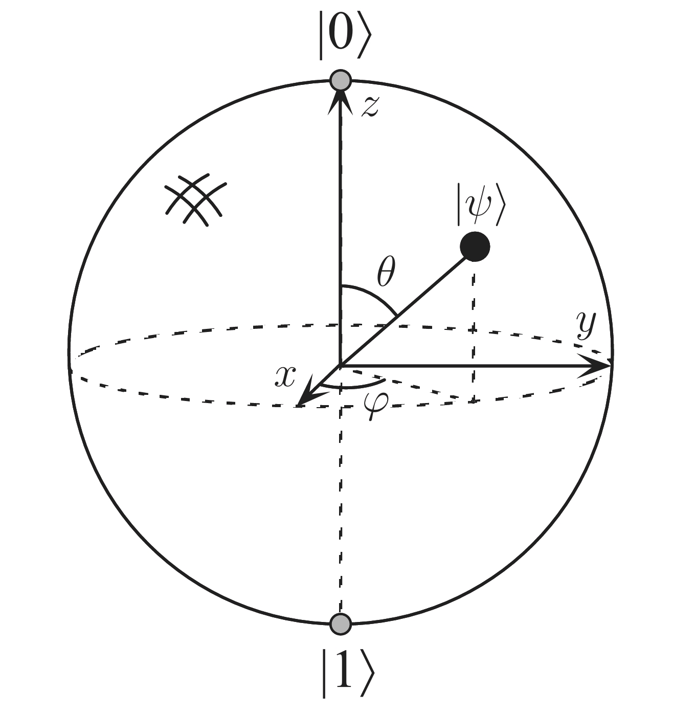

# 4.2 Single Qubit Operations

## 4.2.1. Single Qubit Gates and the Bloch Sphere

!!! definition "Definition 4.2.1 : Pauli and one-qubit gates"
    The single-qubit operators **Pauli matrices** $X$, $Y$, and $Z$, the **Hadamard gate** $H$, the **phase gate** $S$, and the **$\pi/8$ gate** $T$ are given by the following matrices.

    $$
    X \equiv \left[\begin{array}{cc}
    0 & 1 \\
    1 & 0
    \end{array}\right], \quad
    Y \equiv \left[\begin{array}{cc}
    0 & -i \\
    i & 0
    \end{array}\right], \quad
    Z \equiv \left[\begin{array}{cc}
    1 & 0 \\
    0 & -1
    \end{array}\right].
    $$

    $$
    H=\frac{1}{\sqrt{2}}\left[\begin{array}{cc}
    1 & 1 \\
    1 & -1
    \end{array}\right], \quad
    S=\left[\begin{array}{cc}
    1 & 0 \\
    0 & i
    \end{array}\right], \quad
    T=\left[\begin{array}{cc}
    1 & 0 \\
    0 & \exp (i \pi / 4)
    \end{array}\right].
    $$

!!! definition "Definition 4.2.2 : Bloch sphere"
    A single-qubit state has the form

    $$
    |\psi\rangle = e^{i \gamma}\left(\cos \frac{\theta}{2}|0\rangle + e^{i \varphi} \sin \frac{\theta}{2}|1\rangle\right).
    $$

    By **Concept 2.2.31**, the global phase factor $e^{i\gamma}$ can be ignored, and so we write

    $$
    |\psi\rangle = \cos \frac{\theta}{2}|0\rangle + e^{i\varphi} \sin \frac{\theta}{2}|1\rangle.
    $$

    The real pair $(\theta, \varphi)$ defines a point on a unit three-dimensional sphere, known as the **Bloch sphere representation**.
    This is useful for visualizing the state of a single qubit and reasoning about single-qubit operations, but there is no simple analogous picture for multiple qubits.

    {: .center style="width:70%;"}
    ///caption
    Figure 4.2.1 : Bloch sphere representation .
    ///

!!! example "Example 4.2.3 : Eigenvectors of the Pauli matrices in the bloch sphere"
    In **Example 2.1.27**, we computed the eigenvectors of the Pauli matrices.
    Here are the normalized eigenvectors and their Bloch-sphere points.

    For the operator $X$,

    $$
    v_x^{+} = \frac{|0\rangle+|1\rangle}{\sqrt{2}} \to (1,0,0),
    v_x^{-} = \frac{|0\rangle-|1\rangle}{\sqrt{2}} \to (-1,0,0).
    $$

    For the operator $Y$,

    $$
    v_y^{+} = \frac{|0\rangle+i|1\rangle}{\sqrt{2}} \to (0,1,0),
    v_y^{-} = \frac{|0\rangle-i|1\rangle}{\sqrt{2}} \to (0,-1,0).
    $$

    For the operator $Z$,

    $$
    v_z^{+} = |0\rangle \to (0,0,1),
    v_z^{-} = |1\rangle \to (0,0,-1).
    $$

## 4.2.2. Rotation Operations

!!! theorem "Lemma 4.2.4"
    Let $x$ be a real number and $A$ be a matrix such that $A^2 = I$.
    Then

    $$
    \exp(i A x)=\cos (x) I+i \sin (x) A.
    $$

    !!! proof
        Because $A^2=I$, every even and odd power of $A$ satisfies $A^{2 k}=I$ and $A^{2 k+1}=A$ for $k\ge 0$.
        Expanding the exponential,

        $$
        \exp(i A x)=\sum_{n=0}^{\infty} \frac{(i A x)^n}{n!}
        =\sum_{k=0}^{\infty} \frac{(i x)^{2 k} A^{2 k}}{(2 k)!}
        +\sum_{k=0}^{\infty} \frac{(i x)^{2 k+1} A^{2 k+1}}{(2 k+1)!}.
        $$

        Therefore

        $$
        \exp(i A x)=\left(\sum_{k=0}^{\infty}(-1)^k \frac{x^{2 k}}{(2 k)!}\right) I
        +i\left(\sum_{k=0}^{\infty}(-1)^k \frac{x^{2 k+1}}{(2 k+1)!}\right) A.
        $$

        By the standard power series definitions, the first sum is $\cos (x)$ and the second sum is $\sin (x)$.
        Hence

        $$
        \exp(i A x)=\cos (x) I+i \sin (x) A.
        $$

!!! definition "Definition 4.2.5 : Rotation operator"
    The Pauli matrices give rise to three unitary families called **rotation operators**.
    Using **Lemma 4.2.4**, The $x$-, $y$-, and $z$-axis rotations by angle $\theta$ are defined as

    $$
    \begin{align*}
    R_{x}(\theta) &\equiv e^{-i \theta X / 2}=\cos \frac{\theta}{2} I-i \sin \frac{\theta}{2} X=\left[\begin{array}{cc}
    \cos \frac{\theta}{2} & -i \sin \frac{\theta}{2} \\
    -i \sin \frac{\theta}{2} & \cos \frac{\theta}{2}
    \end{array}\right] \\
    R_{y}(\theta) &\equiv e^{-i \theta Y / 2}=\cos \frac{\theta}{2} I-i \sin \frac{\theta}{2} Y=\left[\begin{array}{cc}
    \cos \frac{\theta}{2} & -\sin \frac{\theta}{2} \\
    \sin \frac{\theta}{2} & \cos \frac{\theta}{2}
    \end{array}\right] \\
    R_{z}(\theta) &\equiv e^{-i \theta Z / 2}=\cos \frac{\theta}{2} I-i \sin \frac{\theta}{2} Z=\left[\begin{array}{cc}
    e^{-i \theta / 2} & 0 \\
    0 & e^{i \theta / 2}
    \end{array}\right].
    \end{align*}
    $$

!!! theorem "Lemma 4.2.6 : Pauli vector square"
    Let $\hat n=(n_x,n_y,n_z)$ be a unit vector.
    Show

    $$
    (\hat n\cdot\vec{\sigma})^2=I.
    $$

    Here $\hat n\cdot\vec{\sigma}=n_x\sigma_x+n_y\sigma_y+n_z\sigma_z$.

    !!! proof
        Expand.

        $$
        (\hat n\cdot\vec{\sigma})^2
        =\sum_{j,k\in\{x,y,z\}} n_jn_k\,\sigma_j\sigma_k.
        $$

        Since $n_jn_k$ is symmetric in $j,k$, we keep the symmetric part of $\sigma_j\sigma_k$.
        Thus

        $$
        (\hat n\cdot\vec{\sigma})^2
        =\frac{1}{2}\sum_{j,k} n_jn_k(\sigma_j\sigma_k+\sigma_k\sigma_j).
        $$

        Using the Pauli anticommutation relation from **Example 2.1.70**,

        $$
        \sigma_j\sigma_k+\sigma_k\sigma_j=2\delta_{jk}I.
        $$

        Therefore

        $$
        (\hat n\cdot\vec{\sigma})^2
        =\sum_{j,k}n_jn_k\delta_{jk}I
        =\sum_j n_j^2I
        =(\hat n\cdot\hat n)I.
        $$

        Since $\hat n$ is unit, $\hat n\cdot\hat n=1$.
        Hence $(\hat n\cdot\vec{\sigma})^2=I$.

!!! definition "Definition 4.2.7 : General rotation operator"
    If $\hat{n}=(n_{x}, n_{y}, n_{z})$ is a real unit vector in three dimensions, then we define the **general rotation operator** by a rotation by $\theta$ about the $\hat{n}$ axis as

    $$
    \begin{equation*}
    R_{\hat{n}}(\theta) \equiv \exp (-i \theta \hat{n} \cdot \vec{\sigma} / 2)=\cos \left(\frac{\theta}{2}\right) I-i \sin \left(\frac{\theta}{2}\right)\left(n_{x} X+n_{y} Y+n_{z} Z\right)
    \end{equation*}
    $$

    where $\vec{\sigma}$ denotes the three component vector $(X, Y, Z)$ of Pauli matrices.

!!! theorem "Theorem 4.2.8 : Bloch sphere interpretation of rotations"
    $R_{\hat{n}}(\theta)$ acts on Bloch vectors as a geometric rotation.
    If a single-qubit state has Bloch vector $\vec{\lambda}$, then after applying $R_{\hat{n}}(\theta)$ its Bloch vector is the rotated vector

    $$
    \vec{\lambda}'=R_{\mathrm{B}}(\theta,\hat{n})\vec{\lambda},
    $$

    where $R_{\mathrm{B}}(\theta,\hat{n})$ is the ordinary rotation of $\mathbb{R}^{3}$ by angle $\theta$ about the axis $\hat{n}$.
    Equivalently, this geometric fact explains the factor of two in the definition of $R_{\hat{n}}(\theta)$.

    !!! proof
        A pure state with Bloch vector $\vec{\lambda}$ has density operator

        $$
        \rho=\frac{I+\vec{\lambda}\cdot\vec{\sigma}}{2}.
        $$

        Under $R_{\hat{n}}(\theta)$ the state evolves as $\rho'=R_{\hat{n}}(\theta)\rho R_{\hat{n}}(\theta)^{\dagger}$.
        Using the Pauli operator identity

        $$
        R_{\hat{n}}(\theta)\,\sigma_{k}\,R_{\hat{n}}(\theta)^{\dagger}
        =\sum_{j=1}^{3}\!\left[R_{\mathrm{B}}(\theta,\hat{n})\right]_{kj}\sigma_{j},
        $$

        the matrix $R_{\mathrm{B}}(\theta,\hat{n})$ is orthogonal with determinant one and represents a rigid rotation of angle $\theta$ around $\hat{n}$.
        Therefore

        $$
        \rho'=\frac{I+\left(R_{\mathrm{B}}(\theta,\hat{n})\vec{\lambda}\right)\cdot\vec{\sigma}}{2},
        $$

        so the Bloch vector is exactly $R_{\mathrm{B}}(\theta,\hat{n})\vec{\lambda}$.
        This is a rotation by angle $\theta$ about the $\hat{n}$ axis.

!!! theorem "Theorem 4.2.9 : Composition of single qubit operations"
    The product of two single-qubit rotations $R_{\hat n_2}(\beta_2)R_{\hat n_1}(\beta_1)$ is itself a single rotation $R_{\hat n_{12}}(\beta_{12})$.
    
    Let $c_i=\cos(\beta_i / 2)$, $s_i=\sin(\beta_i / 2)$, $c_{12}=\cos(\beta_{12}/2)$, and $s_{12}=\sin(\beta_{12}/2)$.
    Then

    $$
    c_{12}=c_1 c_2-s_1 s_2 \, \hat n_1\cdot\hat n_2
    $$

    and

    $$
    s_{12}\hat n_{12}=s_1 c_2\,\hat n_1+c_1 s_2\,\hat n_2-s_1 s_2\,\hat n_2\times\hat n_1.
    $$

    If $\beta_1=\beta_2=\beta$ and $\hat n_1=\hat z$, then with $c=c_1=c_2$ and $s=s_1=s_2$, the same formulas become

    $$
    c_{12}=c^2-s^2\,\hat z\cdot\hat n_2
    $$

    and

    $$
    s_{12}\hat n_{12}=sc(\hat z+\hat n_2)-s^2\,\hat n_2\times\hat z
    $$

    !!! proof
        Use the rotation-operator form $R_{\hat n}(\beta)=\cos(\beta/2)I-i\sin(\beta/2)\,\hat n\cdot\vec{\sigma}=cI-is\,\hat n\cdot\vec{\sigma}$.
        Multiply

        $$
        R_{\hat n_2}(\beta_2)R_{\hat n_1}(\beta_1)
        =(c_2I-is_2\,\hat n_2\cdot\vec{\sigma})(c_1I-is_1\,\hat n_1\cdot\vec{\sigma})
        $$

        and use the Pauli-product identity

        $$
        (\hat a\cdot\vec{\sigma})(\hat b\cdot\vec{\sigma})=\hat a\cdot\hat b\,I+i(\hat a\times\hat b)\cdot\vec{\sigma}.
        $$

        Then

        $$
        R_{\hat n_2}(\beta_2)R_{\hat n_1}(\beta_1)
        =(c_1c_2-s_1s_2\,\hat n_1\cdot\hat n_2)I
        -i[s_1c_2\,\hat n_1+c_1s_2\,\hat n_2+s_1s_2\,\hat n_1\times\hat n_2]\cdot\vec{\sigma}.
        $$

        Since $\hat n_1\times\hat n_2=-\hat n_2\times\hat n_1$, the vector coefficient of $-i\cdot\vec{\sigma}$ is exactly

        $$
        s_1c_2\,\hat n_1+c_1s_2\,\hat n_2-s_1s_2\,\hat n_2\times\hat n_1,
        $$

        giving the first pair of equations.
        For $\beta_1=\beta_2=\beta$ and $\hat n_1=\hat z$, substitution gives the second pair directly.

## 4.2.3. Decomposition of a Single Qubit Unitary Operation

!!! theorem "Theorem 4.2.10 : Single-qubit unitary as phase and axis-angle rotation"
    Any single-qubit unitary operator can be written in the form

    $$
    U=e^{i\alpha}R_{\hat n}(\theta)
    $$

    for real numbers $\alpha,\theta$ and a real three-dimensional unit vector $\hat n$.

    !!! proof
        Let $U$ be a single-qubit unitary operator.
        Write $\det(U)=e^{2 i\alpha}$ for some real $\alpha$ and define

        $$
        V\equiv e^{-i\alpha}U.
        $$

        Then $\det(V)=1$ and $V^\dagger V=I$, so $V\in SU(2)$.
        Every element of $SU(2)$ has the form

        $$
        V=\begin{pmatrix}
        a & b\\
        -b^* & a^*
        \end{pmatrix}
        $$

        with $|a|^2+|b|^2=1$.
        Write $a=a_R+i a_I$ and define

        $$
        \theta\equiv 2\arccos(a_R)\in[0,2\pi).
        $$

        If $\sin(\theta/2)=0$, then $\theta\in\{0,2\pi\}$.
        Then $V=\pm I$, which is equal to $R_{\hat n}(\theta)$ for any unit $\hat n$.

        Assume now $\sin(\theta/2)\neq 0$.
        Define

        $$
        \hat n_x\equiv-\frac{\Im(b)}{\sin(\theta/2)},\quad
        \hat n_y\equiv\frac{\Re(b)}{\sin(\theta/2)},\quad
        \hat n_z\equiv-\frac{\Im(a)}{\sin(\theta/2)}.
        $$

        Each component is real.
        Then

        $$
        \hat n_x^2+\hat n_y^2+\hat n_z^2
        =\frac{(\Re (b))^2+(\Im (b))^2+(\Im (a))^2}{\sin^2(\theta/2)}
        =\frac{|b|^2+|a|^2-a_R^2}{1-a_R^2}=1,
        $$

        so $\hat n$ is a unit vector.
        Using the Pauli matrices $X,Y,Z$, we get

        $$
        V=\cos(\theta/2)I-i\sin(\theta/2)(\hat n_xX+\hat n_yY+\hat n_zZ)=R_{\hat n}(\theta).
        $$

        Therefore

        $$
        U=e^{i\alpha}R_{\hat n}(\theta).
        $$

!!! theorem "Theorem 4.2.11 : Z-Y decomposition for a single qubit"
    Suppose $U$ is a single-qubit unitary operation.
    Then there are real numbers $\alpha$, $\beta$, $\gamma$, and $\delta$ such that

    $$
    U=e^{i \alpha} R_{z}(\beta) R_{y}(\gamma) R_{z}(\delta).
    $$

    !!! proof
        Let

        $$
        U=\begin{pmatrix} a & b \\ c & d \end{pmatrix}.
        $$

        Since $U$ is unitary, we may factor out a global phase and write

        $$
        U=e^{i\alpha}V,
        $$

        where $V\in SU(2)$.
        A general matrix in $SU(2)$ has the form

        $$
        V=
        \begin{pmatrix}
        u & -v^{*} \\
        v & u^{*}
        \end{pmatrix},
        \qquad
        |u|^{2}+|v|^{2}=1.
        $$

        Since $|u|^{2}+|v|^{2}=1$, there is a real number $\gamma$ such that

        $$
        |u|=\cos \frac{\gamma}{2},
        \qquad
        |v|=\sin \frac{\gamma}{2}.
        $$

        Also, there are real numbers $\beta$ and $\delta$ such that

        $$
        u=e^{-i(\beta+\delta)/2}\cos \frac{\gamma}{2},
        \qquad
        v=e^{\,i(\beta-\delta)/2}\sin \frac{\gamma}{2}.
        $$

        Therefore

        $$
        V=
        \begin{pmatrix}
        e^{-i(\beta+\delta)/2}\cos \frac{\gamma}{2}
        &
        -e^{-i(\beta-\delta)/2}\sin \frac{\gamma}{2}
        \\
        e^{\,i(\beta-\delta)/2}\sin \frac{\gamma}{2}
        &
        e^{\,i(\beta+\delta)/2}\cos \frac{\gamma}{2}
        \end{pmatrix}.
        $$

        Now compute

        $$
        R_z(\beta)=
        \begin{pmatrix}
        e^{-i\beta/2} & 0 \\
        0 & e^{i\beta/2}
        \end{pmatrix},
        \qquad
        R_y(\gamma)=
        \begin{pmatrix}
        \cos \frac{\gamma}{2} & -\sin \frac{\gamma}{2} \\
        \sin \frac{\gamma}{2} & \cos \frac{\gamma}{2}
        \end{pmatrix},
        \qquad
        R_z(\delta)=
        \begin{pmatrix}
        e^{-i\delta/2} & 0 \\
        0 & e^{i\delta/2}
        \end{pmatrix}.
        $$

        Multiplying these matrices gives

        $$
        R_z(\beta)R_y(\gamma)R_z(\delta)
        =
        \begin{pmatrix}
        e^{-i(\beta+\delta)/2}\cos \frac{\gamma}{2}
        &
        -e^{-i(\beta-\delta)/2}\sin \frac{\gamma}{2}
        \\
        e^{\,i(\beta-\delta)/2}\sin \frac{\gamma}{2}
        &
        e^{\,i(\beta+\delta)/2}\cos \frac{\gamma}{2}
        \end{pmatrix}.
        $$

        This is exactly $V$.
        Hence

        $$
        V=R_z(\beta)R_y(\gamma)R_z(\delta).
        $$

        Therefore

        $$
        U=e^{i\alpha}V=e^{i\alpha}R_z(\beta)R_y(\gamma)R_z(\delta).
        $$

        This proves the result.

!!! theorem "Theorem 4.2.12 : Decomposition with non-parallel axes"
    Suppose $\hat m$ and $\hat n$ are non-parallel real unit vectors in three dimensions.
    For any single-qubit unitary $U$, there exist real numbers $\alpha$, $\beta$, $\gamma$, and $\delta$ such that

    $$
    U=e^{i\alpha}R_{\hat n}(\beta)R_{\hat m}(\gamma)R_{\hat n}(\delta).
    $$

    !!! proof
        Since $\hat m$ and $\hat n$ are non-parallel, they span a two-dimensional plane in $\mathbb R^3$.
        Choose an orthonormal basis $\{\hat n,\hat m',\hat k\}$ such that $\hat m'$ lies in the plane spanned by $\hat m$ and $\hat n$, and $\hat m'$ is perpendicular to $\hat n$.

        By the Bloch-sphere interpretation of single-qubit rotations, there exists a single-qubit unitary $V$ whose Bloch-sphere action sends the $z$-axis to $\hat n$ and the $y$-axis to $\hat m'$.
        Equivalently,

        $$
        V R_z(\theta) V^\dagger = R_{\hat n}(\theta),
        \qquad
        V R_y(\theta) V^\dagger = R_{\hat m'}(\theta)
        $$

        for all real $\theta$.

        Now define

        $$
        U' = V^\dagger U V.
        $$

        By **Theorem 4.2.11**, there exist real numbers $\alpha,\beta,\gamma,\delta$ such that

        $$
        U' = e^{i\alpha} R_z(\beta) R_y(\gamma) R_z(\delta).
        $$

        Conjugating by $V$, we obtain

        $$
        U = V U' V^\dagger
        = e^{i\alpha}
        \bigl(V R_z(\beta) V^\dagger\bigr)
        \bigl(V R_y(\gamma) V^\dagger\bigr)
        \bigl(V R_z(\delta) V^\dagger\bigr).
        $$

        Therefore

        $$
        U = e^{i\alpha} R_{\hat n}(\beta) R_{\hat m'}(\gamma) R_{\hat n}(\delta).
        $$

        It remains to replace the middle axis $\hat m'$ by the given axis $\hat m$.

        Since $\hat m'$ and $\hat m$ are both unit vectors in the plane spanned by $\hat n$ and $\hat m$, and both are perpendicular to $\hat n$, there exists an angle $\eta$ such that rotation about $\hat n$ by angle $\eta$ sends $\hat m'$ to $\hat m$.
        Hence

        $$
        R_{\hat m}(\gamma)
        =
        R_{\hat n}(\eta)\,R_{\hat m'}(\gamma)\,R_{\hat n}(-\eta).
        $$

        Substituting this into the previous expression gives

        $$
        U
        =
        e^{i\alpha}
        R_{\hat n}(\beta)
        R_{\hat n}(-\eta)
        R_{\hat m}(\gamma)
        R_{\hat n}(\eta)
        R_{\hat n}(\delta).
        $$

        Rotations about the same axis combine by adding angles, so

        $$
        R_{\hat n}(\beta)R_{\hat n}(-\eta)=R_{\hat n}(\beta-\eta),
        \qquad
        R_{\hat n}(\eta)R_{\hat n}(\delta)=R_{\hat n}(\eta+\delta).
        $$

        Therefore

        $$
        U
        =
        e^{i\alpha}
        R_{\hat n}(\beta-\eta)\,
        R_{\hat m}(\gamma)\,
        R_{\hat n}(\eta+\delta).
        $$

        Renaming the outer angles, we obtain

        $$
        U=e^{i\alpha}R_{\hat n}(\beta)R_{\hat m}(\gamma)R_{\hat n}(\delta).
        $$

        This proves the result.

!!! theorem "Theorem 4.2.13"
    $XYX=-Y$ and $X R_{y}(\theta) X=R_{y}(-\theta)$.

    !!! proof
        By direct multiplication,

        $$
        XYX
        =(\ket{0}\bra{1}+\ket{1}\bra{0})(i\ket{1}\bra{0}-i\ket{0}\bra{1})(\ket{0}\bra{1}+\ket{1}\bra{0})
        =-\,\left(i\ket{1}\bra{0}-i\ket{0}\bra{1}\right)
        =-Y.
        $$

        Using $R_{y}(\theta)=\cos\frac{\theta}{2}I-\sin\frac{\theta}{2} iY$,

        $$
        X R_{y}(\theta) X
        =X\left(\cos\frac{\theta}{2}I-\sin\frac{\theta}{2} iY\right)X
        =\cos\frac{\theta}{2}I-\sin\frac{\theta}{2} i(XYX)
        =\cos\frac{\theta}{2}I+\sin\frac{\theta}{2} iY
        =R_y(-\theta).
        $$

!!! theorem "Theorem 4.2.14 : Corollary 4.2"
    Suppose $U$ is a unitary gate on a single qubit.
    Then there exist unitary operators $A, B, C$ on a single qubit such that $A B C=I$ and $U=e^{i \alpha} A X B X C$, where $\alpha$ is some overall phase factor.

    !!! proof
        In the notation of **Theorem 4.2.11**, set $A \equiv R_{z}(\beta) R_{y}(\gamma / 2)$, $B \equiv R_{y}(-\gamma / 2) R_{z}(-(\delta+\beta) / 2)$ and $C \equiv R_{z}((\delta-\beta) / 2)$.
        Note that

        $$
        A B C=R_{z}(\beta) R_{y}\left(\frac{\gamma}{2}\right) R_{y}\left(-\frac{\gamma}{2}\right) R_{z}\left(-\frac{\delta+\beta}{2}\right) R_{z}\left(\frac{\delta-\beta}{2}\right)=I
        $$

        Since $X^{2}=I$, and using **Theorem 4.2.13**, we see that

        $$
        X B X=X R_{y}\left(-\frac{\gamma}{2}\right) X X R_{z}\left(-\frac{\delta+\beta}{2}\right) X=R_{y}\left(\frac{\gamma}{2}\right) R_{z}\left(\frac{\delta+\beta}{2}\right)
        $$

        Thus

        $$
        \begin{align*}
        A X B X C &=R_{z}(\beta) R_{y}\left(\frac{\gamma}{2}\right) R_{y}\left(\frac{\gamma}{2}\right) R_{z}\left(\frac{\delta+\beta}{2}\right) R_{z}\left(\frac{\delta-\beta}{2}\right) \\
        &=R_{z}(\beta) R_{y}(\gamma) R_{z}(\delta)
        \end{align*}
        $$

        Therefore $U=e^{i \alpha} A X B X C$ and $A B C=I$, as required.

!!! theorem "Theorem 4.2.15 : Circuit identities"
    Let $X$, $Y$, $Z$, $H$, and $T$ be the single-qubit gates.
    Then

    $$
    H X H=Z ; H Y H=-Y ; H Z H=X.
    $$

    In addition,

    $$
    H T H=e^{i \pi / 8} R_{x}(\pi / 4),
    $$

    up to a global phase.

    !!! proof
        Use matrix multiplication and identities of the Pauli and Hadamard operators.

        $$
        H=\frac{1}{\sqrt{2}}
        \begin{pmatrix}
        1 & 1 \\
        1 & -1
        \end{pmatrix},
        X=\begin{pmatrix}
        0 & 1 \\
        1 & 0
        \end{pmatrix},
        Y=\begin{pmatrix}
        0 & -i \\
        i & 0
        \end{pmatrix},
        Z=\begin{pmatrix}
        1 & 0 \\
        0 & -1
        \end{pmatrix},
        T=\begin{pmatrix}
        1 & 0 \\
        0 & e^{i\pi/4}
        \end{pmatrix}.
        $$

        $$
        H X H=
        \frac{1}{2}
        \begin{pmatrix}
        1 & 1 \\
        1 & -1
        \end{pmatrix}
        \begin{pmatrix}
        0 & 1 \\
        1 & 0
        \end{pmatrix}
        \begin{pmatrix}
        1 & 1 \\
        1 & -1
        \end{pmatrix}
        =
        \begin{pmatrix}
        1 & 0 \\
        0 & -1
        \end{pmatrix}=Z.
        $$

        $$
        H Y H=
        \frac{1}{2}
        \begin{pmatrix}
        1 & 1 \\
        1 & -1
        \end{pmatrix}
        \begin{pmatrix}
        0 & -i \\
        i & 0
        \end{pmatrix}
        \begin{pmatrix}
        1 & 1 \\
        1 & -1
        \end{pmatrix}
        =
        \begin{pmatrix}
        0 & -i \\
        -i & 0
        \end{pmatrix}=-Y.
        $$

        $$
        H Z H=
        \frac{1}{2}
        \begin{pmatrix}
        1 & 1 \\
        1 & -1
        \end{pmatrix}
        \begin{pmatrix}
        1 & 0 \\
        0 & -1
        \end{pmatrix}
        \begin{pmatrix}
        1 & 1 \\
        1 & -1
        \end{pmatrix}
        =
        \begin{pmatrix}
        0 & 1 \\
        1 & 0
        \end{pmatrix}=X.
        $$

        For the final identity,

        $$
        H T H=
        \frac{1}{2}
        \begin{pmatrix}
        1 & 1 \\
        1 & -1
        \end{pmatrix}
        \begin{pmatrix}
        1 & 0 \\
        0 & e^{i\pi/4}
        \end{pmatrix}
        \begin{pmatrix}
        1 & 1 \\
        1 & -1
        \end{pmatrix}
        =
        \frac{1}{2}
        \begin{pmatrix}
        1+e^{i\pi/4} & 1-e^{i\pi/4} \\
        1-e^{i\pi/4} & 1+e^{i\pi/4}
        \end{pmatrix}.
        $$

        $$
        =e^{i\pi/8}
        \begin{pmatrix}
        \cos(\pi/8) & -i\sin(\pi/8) \\
        -i\sin(\pi/8) & \cos(\pi/8)
        \end{pmatrix}.
        $$

        By the definition of the x-rotation operator, $R_{x}(\theta)=\cos(\theta/2)I-i\sin(\theta/2)X$.
        This gives

        $$
        H T H=e^{i\pi/8}R_{x}(\pi/4).
        $$

        So $H T H$ and $R_{x}(\pi/4)$ differ only by the global phase $e^{i\pi/8}$.

!!! concept "Concept 4.2.16 : Global-phase form of the $T$ gate"
    Up to a global phase, the $\pi / 8$ gate ($T$ gate) is $R_{z}(\pi / 4)$.
    
    Although the definition uses $\pi / 4$, this is a historical naming convention because, up to an overall phase, $T$ is written as

    $$
    T=\exp (i \pi / 8)\left[\begin{array}{cc}
    \exp (-i \pi / 8) & 0 \\
    0 & \exp (i \pi / 8)
    \end{array}\right]
    $$
